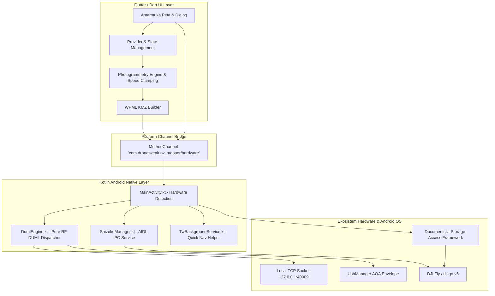

TW-Mapper-Mobile dibangun menggunakan arsitektur modular hibrida: antarmuka pengguna (*User Interface*) responsif berbasis **Flutter/Dart**, dipadukan dengan lapisan pengendali perangkat keras berlatensi rendah (*low-latency hardware controller layer*) berbasis **Kotlin Android Native**.

---

## 🏛️ Diagram Arsitektur Sistem


> [!NOTE]
> *Gambar: Tampilan UI Flutter TW-Mapper Mobile yang terhubung ke lapisan native Kotlin via MethodChannel berkecepatan tinggi.*



---

## 📂 Struktur Direktori Proyek

```
TW-Mapper-Mobile/
├── .github/
│   └── workflows/
│       ├── release.yml             # Otomasi kompilasi APK, obfuscation & rilis GitHub
│       └── deploy-docs.yml         # Otomasi publikasi dokumentasi ke GitHub Pages
├── android/
│   └── app/src/main/kotlin/...
│       ├── DumlEngine.kt           # Pure RF DUML dispatcher & USB/Socket transport
│       ├── MainActivity.kt         # MethodChannel bridge & hardware detection
│       ├── ShizukuManager.kt       # Shizuku Direct Inject KMZ engine
│       └── TwBackgroundService.kt  # Keepalive quick navigator service
├── lib/
│   ├── dialogs/
│   │   ├── about_dialog.dart       # Info versi aplikasi & lisensi
│   │   ├── drone_tools_dialog.dart # Kontrol FCC, Altitude, LED, ATTI & transport badge
│   │   ├── inject_dialog.dart      # Dialog ekspor & penimpaan misi KMZ
│   │   └── why_speed_clamped_dialog.dart # Dialog edukasi speed clamping WanDrone
│   ├── models/                     # Model data misi, waypoint, polygon, dan spesifikasi kamera
│   ├── providers/                  # State management fotogrametri & kalkulasi overlap
│   └── services/                   # Service KMZ generator, DUML bridge, Shizuku, dan file storage
├── release/                        # Artefak rilis lokal & static utility smart controller
├── site/                           # Situs dokumentasi resmi (Astro + Starlight)
├── duml.md                         # Dokumentasi protokol DUML murni & register FC
├── GEMINI.md                       # Instruksi repository khusus asisten AI
└── README.md                       # Ringkasan utama proyek
```

---

## 🧩 Modul-Modul Utama

### 1. `lib/providers/mission_plan_provider.dart`
Mengelola seluruh alur state perencanaan penerbangan:
- Penghitungan titik sudut orientasi sisi terpanjang (*Longest-Edge Alignment*).
- Kalkulasi GSD, Frontlap, Sidelap, dan estimasi waktu terbang.
- Penerapan logika **WanDrone Dynamic Speed Clamping**: $V_{\text{safe\_max}} = D_{\text{foto}} / T_{\min}$.

### 2. `android/app/src/main/kotlin/.../DumlEngine.kt`
Mengatur pengiriman paket biner radio:
- Membuka soket TCP ke `127.0.0.1:40009` pada smart controller atau endpoint USB AOA pada smartphone biasa.
- Memproses 14 Pure RF Recovery Frames tanpa membebani Flight Controller.
- Menghitung CRC8 dan CRC16 pada setiap payload DUML secara native.

### 3. `android/app/src/main/kotlin/.../ShizukuManager.kt`
Mengelola komunikasi IPC dengan layanan sistem Shizuku:
- Mengikat service via AIDL (`IFileSystemService`).
- Menulis file KMZ ke direktori `Android/data/dji.go.v5/files/waypoint/` secara instan tanpa memerlukan hak akses root.
