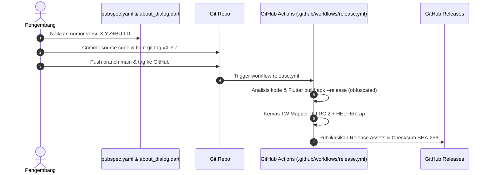

Proyek TW-Mapper-Mobile menerapkan kebijakan rekayasa perangkat lunak yang ketat untuk menjaga performa repositori, integritas kode, dan kecepatan unduhan bagi seluruh kolaborator serta perangkat kontrol drone.

---

## ⚠️ Kebijakan Ketat: Larangan Commit Berkas APK / Binary

> [!CAUTION]
> **DILARANG KERAS MELAKUKAN `git add` ATAU COMMIT PADA BERKAS `.apk`, `.zip`, `.aab`, ATAU DIREKTORI `dist/`.**

### Alasan Larangan:
1. **Mencegah Pembengkakan Git (*Git Bloat*)**: Berkas biner APK berukuran puluhan hingga ratusan megabyte akan merusak ukuran packfile git permanen dan memperlambat proses clone pada smart remote controller DJI yang memiliki memori terbatas.
2. **Keaslian & Keamanan Tanda Tangan**: Build rilis produksi wajib dibangun dan ditandatangani secara resmi oleh lingkungan CI/CD terisolasi (*GitHub Actions Release Keystore*) dengan proteksi obfuscation kode dan split debug symbols.
3. **Pengecualian**: Hanya dua utilitas statis pada direktori `release/DJI RC 2 + HELPER/` yang terlacak di git (`01_PackageInstaller.apk` dan `02_FileManager.apk`). Berkas APK lainnya sepenuhnya diabaikan oleh `.gitignore`.

---

## 👤 Aturan Identitas & Pesan Commit

1. **Zero AI Attribution**:
   Jangan pernah menyertakan atribusi atau tanda tangan AI co-authorship dalam riwayat git commit (seperti `Co-Authored-By: Claude`, `Generated with Antigravity`, dll.).
2. **Identitas Pengembang Resmi**:
   Seluruh commit wajib menggunakan identitas git resmi:
   ```bash
   git commit --author="Dronetweak <radit@arkana.co.id>" -m "pesan commit deskriptif"
   ```
3. **No Force-Push**:
   Dilarang melakukan amend, rebase, atau force-push pada branch `main` setelah commit terpublikasi ke `origin`.

---

## 🚀 Alur Pembuatan Rilis Baru (Release Pipeline)

Untuk merilis versi resmi baru ke publik:




> [!NOTE]
> *Gambar: Pipeline rilis otomatis CI/CD. Seluruh berkas biner dikompilasi, ditandatangani, dan dipublikasikan secara otonom oleh GitHub Actions tanpa commit biner di git.*

1. **Perbarui Versi**:
   Perbarui nomor versi pada `pubspec.yaml` (misal: `version: 0.3.4+3040`).
2. **Selaraskan Tampilan Dialog**:
   Pastikan string versi pada `lib/dialogs/about_dialog.dart` identik (`v0.3.4+3040`).
3. **Commit Perubahan**:
   ```bash
   git add pubspec.yaml lib/dialogs/about_dialog.dart
   git commit --author="Dronetweak <radit@arkana.co.id>" -m "release: v0.3.4 - ringkasan pembaruan"
   ```
4. **Buat & Dorong Git Tag**:
   ```bash
   git tag -a v0.3.4 -m "release: v0.3.4"
   git push origin main && git push origin v0.3.4
   ```
5. **Observasi CI/CD**:
   GitHub Actions akan secara otomatis mengompilasi APK, menandatangani rilis, mengemas bundle helper untuk DJI RC 2, dan mempublikasikan aset rilis di GitHub Releases.
