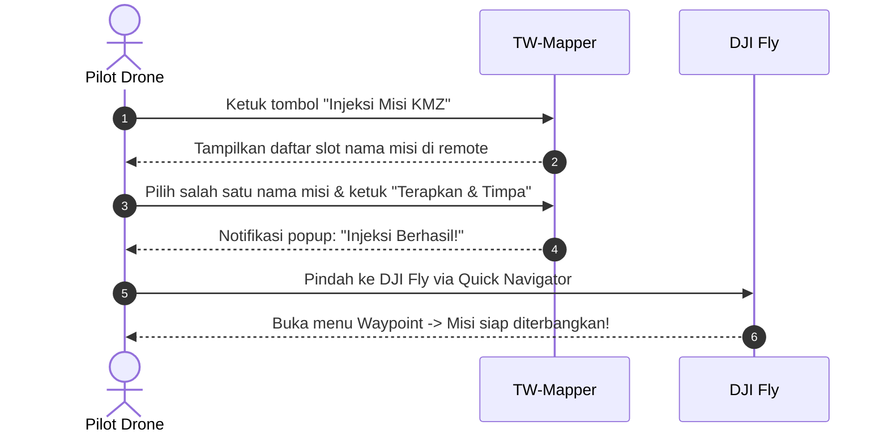

Setelah selesai menggambar batas lahan dan mengatur parameter kamera di TW-Mapper Mobile, langkah berikutnya adalah mengirimkan rute tersebut ke dalam aplikasi resmi **DJI Fly**.

Proses ini dinamakan **Injeksi Misi**. Tidak perlu komputer, kabel USB ke laptop, ataupun koneksi internet!

---

## 🕹️ Cara Injeksi pada Smart Controller (DJI RC 2 / RC Pro)

> [!NOTE]
> *Gambar 4.1: Dialog Injeksi Misi KMZ (WPML). (1) Pemilih slot misi target di memori DJI Fly, (2) Tombol eksekusi penimpaan misi seketika dengan proteksi Safe-Backup, dan (3) Verifikasi ringkasan payload KMZ.*

1. **Tekan Tombol Injeksi**:
   Di layar TW-Mapper sebelah kanan bawah, ketuk tombol biru besar **"Injeksi Misi KMZ"**.
2. **Pilih Slot Misi yang Ingin Digunakan**:
   Aplikasi akan membaca slot misi waypoint yang sudah pernah ada di DJI Fly remote Anda. Pilih salah satu nama misi (misal: *Misi Kebun Blok A*).
3. **Konfirmasi Penimpaan**:
   Ketuk tombol **"Terapkan & Timpa"**. TW-Mapper akan membuat salinan cadangan (*safe backup*) secara otomatis, lalu mengganti rutenya dengan grid fotogrametri Anda yang baru.
4. **Buka DJI Fly**:
   Tarik tirai notifikasi atas remote ke bawah, ketuk tombol **DJI Fly** pada Quick Navigator.
5. **Misi Siap**:
   Buka menu Waypoint di DJI Fly. Misi Anda kini sudah langsung tampil dengan seluruh titik foto terpasang sempurna!

---

## 📱 Cara Injeksi pada Smartphone / Tablet (Mode HP)

Jika Anda menggunakan remote standar **DJI RC-N1, RC-N2, atau RC-N3** dengan HP Android:

1. Pastikan aplikasi pendukung **Shizuku** sudah berstatus aktif (*Shizuku is running*).
2. Di TW-Mapper, ketuk tombol **"Injeksi Misi KMZ"**.
3. Pilih metode **"Shizuku Direct Inject"**.
4. Dalam waktu kurang dari 1 detik, berkas rute WPML langsung ditransfer ke folder internal DJI Fly.
5. Buka DJI Fly di HP Anda, masuk ke menu Waypoint Flight, dan rute Anda sudah siap dijalankan!
