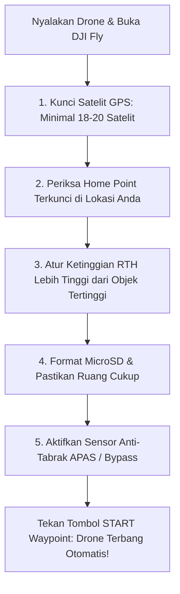

Sebelum menekan tombol *Mulai Terbang (Start)* di menu Waypoint aplikasi DJI Fly, luangkan waktu **30 detik** untuk menjalankan daftar periksa keselamatan lapangan berikut:

---

## ✅ Checklist Pra-Terbang 5 Poin Penting

> [!NOTE]
> *Gambar 4.2: 5 Poin checklist keselamatan pra-terbang. (1) Verifikasi kunci satelit GNSS dan Home Point, (2) Ketinggian RTH fail-safe di atas pohon/rintangan, dan (3) Kesiapan kecepatan tulis MicroSD serta sensor anti-tabrak APAS.*

### 1. Kunci Satelit GPS Kuat (Minimal 18 Satelit)
Tunggu beberapa saat setelah drone dinyalakan di tanah hingga indikator satelit di DJI Fly berubah menjadi warna putih/hijau dengan minimal **18–25 satelit**. Jangan pernah lepas landas jika status GPS masih berwarna kuning/merah.

### 2. Konfirmasi Posisi Home Point
Dengarkan suara dari remote: *"The Home Point has been updated, please check it on the map"*. Pastikan ikon rumah (H) pada peta DJI Fly berada tepat di titik tempat Anda berdiri, bukan di lokasi terbang kemarin.

### 3. Ketinggian Return-to-Home (RTH) Darurat
Buka *Pengaturan DJI Fly* > *Safety*. Atur **RTH Altitude** minimal **15–20 meter lebih tinggi daripada pohon kelapa, tower BTS, atau bukit tertinggi** di sekitar area survei. Jika terjadi putus sinyal darurat (*failsafe*), drone akan naik ke ketinggian aman ini sebelum kembali.

### 4. Kartu Memori MicroSD Siap & Kecepatan U3 / V30
- Pastikan kartu memori yang terpasang di drone memiliki kecepatan tulis tinggi (rating **UHS-I U3 / V30 / SanDisk Extreme**).
- Format kartu memori sebelum misi dimulai agar ruang penyimpanan bersih dan proses penulisan file foto berjalan maksimal tanpa lag.

### 5. Sensor Anti-Tabrak (*Obstacle Avoidance*)
Pastikan mode APAS pada drone diatur ke **Bypass** atau **Brake**, dan lensa sensor optik bersih dari debu atau bekas sidik jari.
