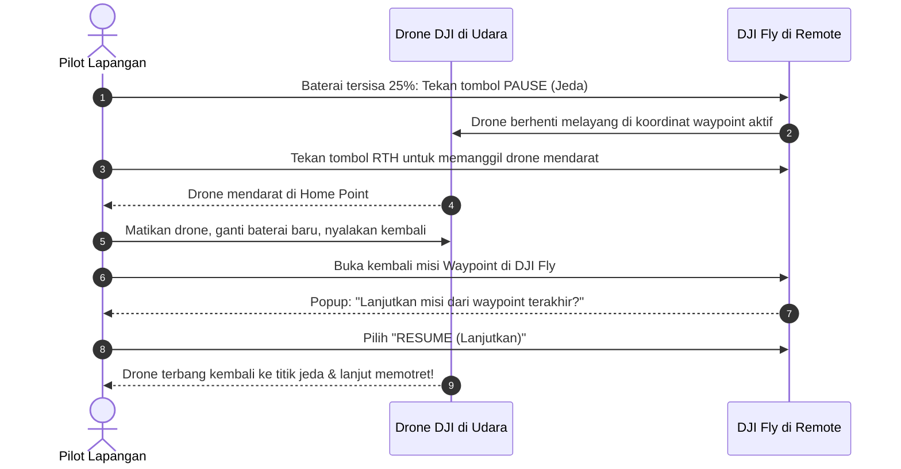

Saat memetakan lahan luas yang membutuhkan waktu lebih dari 20 menit, baterai drone Anda akan habis sebelum seluruh jalur selesai diterbangi. 

Anda **tidak perlu panik dan tidak perlu mengulang misi dari titik awal**! Format rute yang dibuat oleh TW-Mapper Mobile mendukung fitur *Breakpoint Resume* resmi bawaan DJI Fly.

---

## 🔄 Prosedur Langkah demi Langkah

> [!NOTE]
> *Gambar 4.3: Fitur Breakpoint Resume resmi di DJI Fly. (1) Deteksi otomatis nomor waypoint terakhir tempat drone dihentikan, dan (2) Tombol "Lanjutkan Misi (RESUME)" untuk menyambung pemotretan tanpa mengulang dari awal.*

---

## 📋 Detail Langkah Tindakan:

### 1. Tekan Tombol Jeda (Pause)
Saat baterai drone menunjukkan sisa **25% – 30%**, segera tekan tombol **Pause** di layar remote (atau tekan tombol jeda darurat pada joystick fisik). 
- Drone akan seketika menghentikan pergerakan dan melayang diam (*hover*) di posisinya saat itu.
- Sistem DJI Fly secara otomatis menyimpan nomor waypoint persis tempat drone dihentikan.

### 2. Panggil Drone Pulang (RTH)
Tekan dan tahan tombol **Return-to-Home (RTH)** pada remote. Drone akan terbang pulang dan mendarat mulus di titik lepas landas Anda.

### 3. Penggantian Baterai
- Matikan drone, lepas baterai yang telah habis, dan pasang baterai baru yang terisi penuh 100%.
- Nyalakan drone kembali dan tunggu hingga GPS mengunci satelit penuh.
- *Penting: Jangan mengubah atau mengutak-atik rute di TW-Mapper selama proses pergantian baterai ini berlangsung.*

### 4. Tekan "Resume" di DJI Fly
- Buka kembali menu **Waypoint** di DJI Fly dan pilih misi yang sedang berjalan tadi.
- Sebuah jendela dialog konfirmasi akan otomatis muncul:
  > *"Terdapat misi yang belum selesai. Lanjutkan dari Waypoint terakhir?"*
- Pilih **Resume / Lanjutkan**.
- Drone akan otomatis terbang meluncur kembali ke titik koordinat terakhir ia dihentikan, lalu melanjutkan sisa lajur pemotretan hingga selesai tuntas!
