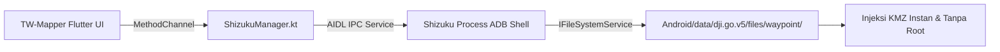

Pada smartphone dan tablet modern berbasis **Android 11, 12, 13, dan 14+**, Google menerapkan kebijakan keamanan ketat bernama **Scoped Storage**. Kebijakan ini memblokir aplikasi pihak ketiga biasa untuk membaca maupun menulis file di dalam folder `Android/data/`.

Bagi pilot yang menggunakan remote controller **DJI RC-N1, RC-N2, atau RC-N3** dengan smartphone atau tablet, memindahkan file misi secara manual menggunakan laptop atau aplikasi file manager yang rumit sangat merepotkan saat bertugas di tengah hutan atau perkebunan.

---

## ⚡ Solusi Inovatif: Shizuku UserService AIDL IPC

TW-Mapper-Mobile mengimplementasikan engine khusus bernama **Shizuku Direct Inject** (`ShizukuManager.kt`) yang memanfaatkan antarmuka IPC resmi Android:

> [!NOTE]
> *Gambar: Status layanan Shizuku dan jendela otorisasi transfer berkas WPML KMZ di smartphone Android.*

### Mengapa Shizuku Lebih Unggul?
- **Tanpa Root**: Tidak perlu melakukan rooting pada smartphone Android Anda, sehingga garansi perangkat dan aplikasi perbankan tetap aman 100%.
- **Transfer Seketika (<1 Detik)**: Berkas KMZ ditulis langsung oleh proses ADB shell tingkat sistem ke dalam folder DJI Fly dalam hitungan milidetik.
- **Otomatis & Tanpa Dialog**: Setelah Shizuku diberi izin sekali, injeksi di masa mendatang berjalan dengan satu kali sentuhan tombol tanpa menampilkan dokumen picker yang membingungkan.

---

## 📋 Panduan Setup Shizuku untuk Pilot

1. **Unduh Aplikasi Shizuku**:
   Pasang aplikasi Shizuku dari Google Play Store atau GitHub resmi.
2. **Aktifkan Opsi Pengembang**:
   Buka *Pengaturan Android* > *Tentang Ponsel*, ketuk *Nomor Kompilasi (Build Number)* sebanyak 7 kali hingga muncul pesan "Anda sekarang seorang pengembang".
3. **Mulai Layanan via Wireless Debugging**:
   - Di Pengaturan Android, buka *Opsi Pengembang* > aktifkan **Wireless Debugging (Proses Debug Nirkabel)**.
   - Buka aplikasi Shizuku, pilih *Pairing (Penyandingan)*, masukkan kode 6 angka yang muncul di notifikasi.
   - Tekan **Start (Mulai)** di aplikasi Shizuku hingga muncul status *"Shizuku is running"*.
4. **Hubungkan dengan TW-Mapper**:
   - Buka menu Injeksi KMZ di TW-Mapper-Mobile.
   - Tekan tombol **"Gunakan Shizuku Direct Inject"**.
   - Sebuah popup konfirmasi akan muncul; pilih **"Izinkan Selalu"** (*Allow always*).
5. **Selesai!** Anda kini dapat menyuntikkan misi kapan saja langsung ke DJI Fly secara otonom di lapangan.
