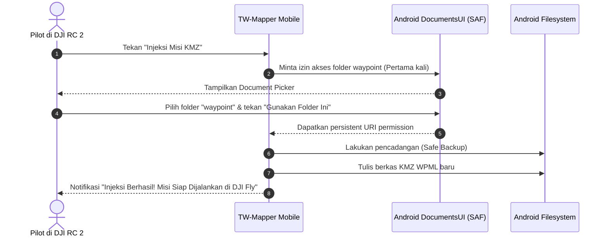

Pada smart controller DJI (seperti **DJI RC 2** dan **DJI RC Pro**), sistem operasi Android yang digunakan mengisolasi direktori aplikasi demi keamanan.

**TW-Mapper-Mobile** memanfaatkan **Storage Access Framework (SAF)** resmi Android yang dijembatani oleh komponen sistem `DocumentsUI` untuk menyuntikkan misi KMZ langsung ke dalam folder misi DJI Fly tanpa memerlukan modifikasi firmware atau akses root.

---

## 📂 Jalur Direktori Target

Di dalam filesystem Android smart controller DJI, misi waypoint disimpan pada lokasi:

```
Android/data/dji.go.v5/files/waypoint/
```

Setiap misi disimpan di dalam sebuah subfolder unik yang berisi file berkas `.kmz`.

---

## 🚀 Prosedur Injeksi Langkah Demi Langkah




> [!NOTE]
> *Gambar: Tampilan dialog pemilihan slot misi dan eksekusi injeksi rute KMZ langsung ke filesystem internal remote DJI RC 2 via SAF.*

1. **Buka Menu Injeksi di TW-Mapper**:
   Setelah selesai merancang poligon atau jalur koridor, klik tombol **"Injeksi Misi KMZ"** di sudut kanan bawah.
2. **Pemberian Izin Folder (Hanya Satu Kali)**:
   - Jika ini pertama kali Anda menggunakan aplikasi, Android DocumentsUI akan terbuka.
   - Masuk ke folder: `Android` > `data` > `dji.go.v5` > `files` > `waypoint`.
   - Tekan tombol biru di bagian bawah layar: **"Gunakan folder ini"** (*Use this folder*), lalu pilih **Izinkan** (*Allow*).
3. **Penyimpanan Izin Persisten**:
   TW-Mapper akan menyimpan *persistent URI grant* dari Android, sehingga untuk misi-misi selanjutnya Anda tidak perlu lagi memilih folder secara manual.
4. **Pilih Slot Misi yang Ingin Ditimpa**:
   Aplikasi akan menampilkan daftar nama misi yang ada di remote. Pilih salah satu slot misi, lalu tekan **"Terapkan & Timpa"**.
5. **Buka DJI Fly**:
   Beralih ke DJI Fly menggunakan **Quick Navigator Helper**, buka menu Waypoint, dan misi baru Anda sudah tampil seketika!

---

## 💡 Tips & Trik Smart Controller

> [!NOTE]
> Pastikan aplikasi pembantu `02_FileManager.apk` (DocumentsUI Shortcut) dari paket rilis sudah terpasang jika sistem smart controller Anda menyembunyikan akses ke direktori `Android/data/`.
