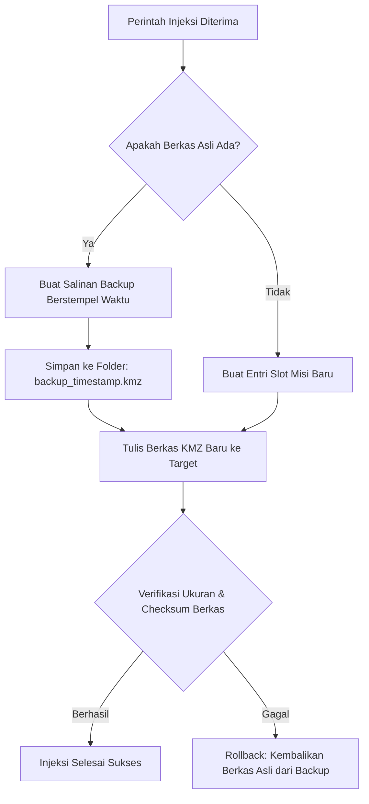

Saat pilot memilih salah satu slot misi di DJI Fly untuk ditimpa dengan rencana jalur terbang fotogrametri baru dari TW-Mapper-Mobile, integritas data misi asli adalah prioritas tertinggi.

Kehilangan misi bawaan yang sudah diatur sebelumnya (*loss of original waypoints*) atau terjadinya kegagalan penulisan di tengah proses (*partial write corruption*) dapat mengacaukan operasional lapangan.

---

## 🛡️ Mekanisme Safe Backup TW-Mapper

Sebelum TW-Mapper menulis satu byte pun ke dalam berkas target `template.kml` atau `waylines.wpml`, engine injeksi secara otomatis menjalankan siklus pencadangan:

### 1. Pencadangan Berstempel Waktu (*Timestamped Backup*)
Setiap berkas asli yang akan ditimpa diduplikasi ke folder penyimpanan lokal aplikasi dengan format nama:
`misi_original_YYYYMMDD_HHMMSS.kmz.bak`.

### 2. Penulisan Atomik (*Atomic Replacement*)
Berkas baru tidak ditulis langsung ke file tujuan secara sekuensial. Sebaliknya, berkas ditulis terlebih dahulu ke file temporer (`.tmp`). Begitu seluruh isi arsip ZIP KMZ selesai ditulis dan di-flush ke disk secara sempurna, operasi rename/replace atomik dijalankan.

### 3. Proteksi Rollback Otomatis
Jika terjadi gangguan (misalnya baterai remote mendadak habis atau memori penuh saat proses penulisan berlangsung):
- Sistem mendeteksi adanya kegagalan verifikasi arsip.
- Salinan cadangan (*backup copy*) langsung dikembalikan ke posisi semula secara otomatis.
- File misi asli tetap utuh dan DJI Fly tidak akan mengalami crash akibat file korup.

---

## ↺ Memulihkan Berkas Misi Asli

> [!NOTE]
> *Gambar: Brankas Safe-Backup TW-Mapper Mobile. Setiap misi asli yang pernah ditimpa dapat dipulihkan kapan saja ke memori DJI Fly.*

Jika suatu saat pilot ingin mengembalikan misi lama yang pernah ditimpa:
1. Buka menu **Pengaturan** di TW-Mapper-Mobile.
2. Masuk ke sub-menu **Riwayat Cadangan Misi (Mission Backup History)**.
3. Pilih tanggal dan jam pencadangan yang diinginkan, lalu pilih **"Pulihkan ke DJI Fly"**.
