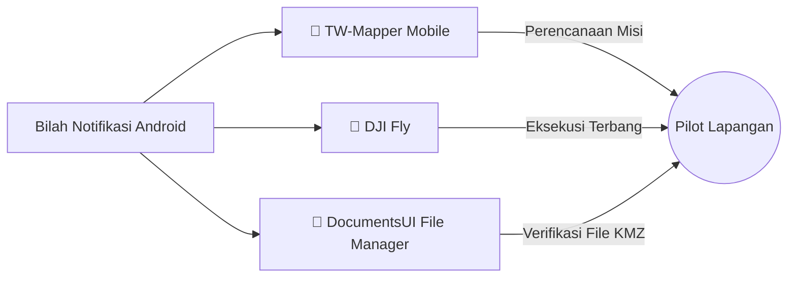

Salah satu kendala terbesar pilot drone saat menggunakan smart controller DJI (seperti **DJI RC 2** dan **DJI RC Pro**) adalah ketiadaan tombol navigasi fisik atau virtual (*Home* atau *Recent Apps*) ketika aplikasi **DJI Fly** sedang berjalan dalam mode layar penuh (*immersive fullscreen*).

Untuk kembali ke aplikasi lain, pilot biasanya harus melakukan gestur geser ganda dari tepi layar yang sering kali tidak responsif saat jari terkena debu lapangan atau cuaca terik.

---

## ⚡ Solusi TW-Mapper: Quick Navigator Helper

TW-Mapper-Mobile menghadirkan layanan latar depan (*Foreground Service*) terpadu yang menampilkan kontrol akses cepat pada bilah status (**Android Notification Drawer**).

> [!NOTE]
> *Gambar: Kartu kendali cepat Quick Navigator pada bilah tirai notifikasi Android remote kontrol DJI RC 2.*

### Tombol Aksi Cepat:
1. **TW-Mapper**: Membawa pilot kembali ke antarmuka peta dan perencanaan misi fotogrametri TW-Mapper secara instan.
2. **DJI Fly**: Meluncurkan atau membawa proses aplikasi `dji.go.v5` ke latar depan untuk langsung mengeksekusi misi waypoint.
3. **DocumentsUI**: Membuka antarmuka file manager sistem untuk melihat isi folder `Android/data/dji.go.v5/files/waypoint` bila pilot ingin memverifikasi backup secara visual.

---

## ⚙️ Logika Deteksi Perangkat Cerdas

Quick Navigator Helper tidak akan membebani status bar pengguna smartphone biasa:

- **Mode RC (DJI RC 2 / RC Pro)**:
  - Layanan helper notification **aktif otomatis** saat aplikasi dibuka.
  - Memastikan alur kerja transisi antar-aplikasi di remote berjalan mulus.
- **Mode HP / TAB (Smartphone & Tablet)**:
  - Layanan helper notification **dinonaktifkan** demi mempertahankan kenyamanan antarmuka smartphone standar, di mana tombol *Recent Apps* dan *Home* bawaan Android sudah tersedia.

---

## 🔒 Stabilitas Latar Belakang

Service helper ini didesain sangat ringan (*zero CPU overhead*) dan tidak menjalankan komputasi berulang di latar belakang:
- Menggunakan `NotificationChannel` prioritas rendah (`IMPORTANCE_LOW`) agar tidak mengeluarkan bunyi notifikasi berulang.
- Mengirimkan intent peluncuran dengan flag `FLAG_ACTIVITY_NEW_TASK | FLAG_ACTIVITY_REORDER_TO_FRONT`, sehingga transisi aplikasi berlangsung seketika tanpa me-restart state atau form misi yang sedang pilot isi.
