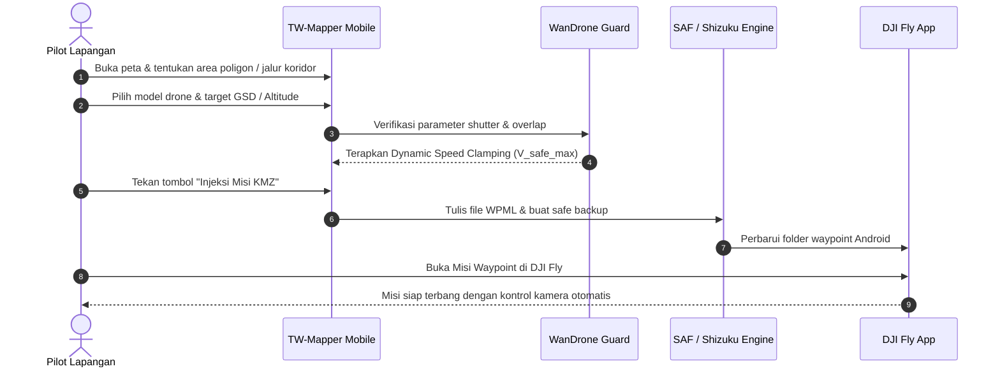

Berikut adalah siklus operasional standar yang dirancang oleh WanDrone dan Throttle Warrior untuk operasi pemetaan udara di lapangan:

> [!NOTE]
> *Gambar: Diagram alur kerja lengkap pemetaan udara terintegrasi tanpa memerlukan laptop di lapangan.*

---

## 1. Membuat Area Survei pada Peta
1. Buka aplikasi **TW-Mapper-Mobile**.
2. Pilih jenis misi:
   - **Grid Poligon** (untuk area perkebunan, pertambangan, atau perumahan).
   - **Koridor** (untuk survei jalan raya, transmisi listrik, atau sungai).
   - **Double Grid** (untuk pemodelan rekonstruksi fasad 3D bangunan).
3. Buat titik-titik koordinat pada peta satelit. Sistem secara cerdas akan mendeteksi orientasi sisi poligon terpanjang (*longest-edge*) dan langsung menyusun jalur terbang yang paling efisien.

---

## 2. Pemilihan Sensor & Kalkulasi Fotogrametri
1. Pilih model drone yang digunakan (misal: *DJI Air 3*, *Mavic 3 Series*, *Mini 4 Pro*).
2. Atur ketinggian terbang rencana ($H$). Sistem akan langsung menghitung resolusi pixel lapangan (*Ground Sampling Distance* / GSD).
3. Atur target overlap:
   - **Frontlap**: Direkomendasikan 75% – 80%.
   - **Sidelap**: Direkomendasikan 65% – 75%.
4. Amati pembatasan kecepatan (*speed clamping*):
   - Jika Anda menggunakan mode sensor resolusi tinggi (48 MP / 50 MP), sistem akan memastikan kecepatan drone tidak melampaui kemampuan buffer sensor kamera ($V_{\text{safe\_max}} = D_{\text{foto}} / 5.0\text{s}$).

---

## 3. Ekspor & Injeksi Misi KMZ
1. Tekan tombol **"Injeksi Misi KMZ"** pada bilah tindakan kanan bawah.
2. Dialog injeksi akan menampilkan ringkasan misi:
   - Jumlah Waypoint.
   - Total Jarak Tempuh & Estimasi Waktu Terbang.
   - Total Perkiraan Jumlah Jepretan Foto.
3. Pilih metode penulisan:
   - **Mode RC (SAF)**: Pilih folder waypoint target pada dokumen picker Android jika baru pertama kali.
   - **Mode HP/TAB (Shizuku)**: Tekan injeksi langsung dan file akan tersalin dalam waktu kurang dari 1 detik.

---

## 4. Eksekusi Penerbangan di DJI Fly
1. Gunakan bilah notifikasi **Quick Navigator Helper** untuk membuka **DJI Fly**.
2. Masuk ke menu **Waypoint Flight** (Rute Titik Arah).
3. Buka misi yang baru saja diinjeksi.
4. Periksa kembali Home Point dan ketinggian RTH (*Return-to-Home*).
5. Tekan tombol **Start / Terbang** untuk memulai misi otonom! Kamera drone akan memotret secara otomatis sesuai interval jarak yang sudah dirancang oleh TW-Mapper.
