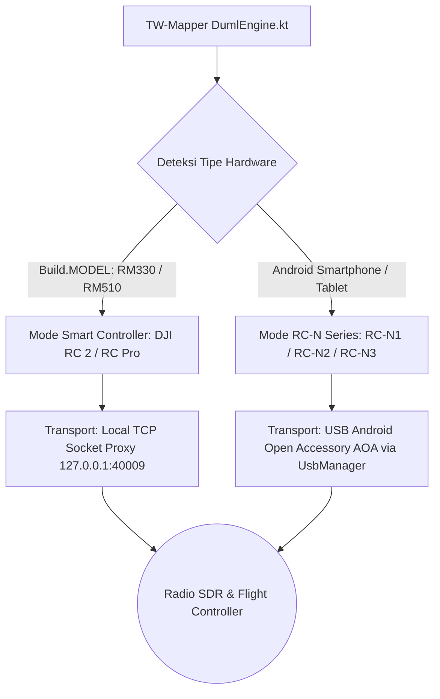

Untuk mengendalikan parameter radio dan komunikasi hardware dengan drone DJI, TW-Mapper-Mobile mengimplementasikan subsistem komunikasi ganda (**Dual Transport Dispatcher**) di dalam layer Kotlin native (`DumlEngine.kt`).

Subsistem ini secara otomatis mendeteksi jenis perangkat keras yang sedang digunakan oleh pilot dan mengaktifkan saluran transport yang sesuai.

---

## 🔀 Dua Jalur Komunikasi Hardware




> [!NOTE]
> *Gambar: Panel Drone Tools yang memanfaatkan arsitektur Dual Transport untuk komunikasi tingkat rendah ke remote dan drone.*

---

## 1. Smart Controller Transport (TCP Proxy)

Pada smart remote bawaan DJI (**DJI RC 2** dan **DJI RC Pro**), sistem Android remote menjalankan daemon internal DJI yang membuka port proxy lokal:

- **Target Socket**: `127.0.0.1:40009` (TCP)
- **Mekanisme**: `DumlEngine.kt` membuka socket client lokal langsung ke port `40009`. Paket DUML dikirimkan tanpa envelope tambahan dan langsung di-forward oleh daemon remote ke modul radio RF internal (SDR).
- **Keuntungan**: Tidak memerlukan kabel fisik tambahan, sangat stabil, dan latensi transmisi di bawah 2 milidetik.

---

## 2. Smartphone & Tablet Transport (USB AOA Logiclink)

Ketika pilot menggunakan remote kontrol **DJI RC-N1, RC-N2, atau RC-N3** yang dihubungkan ke smartphone/tablet Android melalui kabel USB OTG:

- **Protokol**: Android Open Accessory (AOA) 2.0 via `android.hardware.usb.UsbManager`.
- **Envelope Logiclink 8-Byte**:
  Paket DUML harus dibungkus dengan header logiclink sebelum dikirimkan ke endpoint USB bulk transfer:
  ```
  0x55 0xCC 0x49('I') 0x57('W') [len_lo] [len_hi] 0x00 0x00 [Paket DUML...]
  ```
- **Penanganan Hot-plug**:
  `MainActivity.kt` mendengarkan intent `UsbManager.ACTION_USB_ACCESSORY_ATTACHED` dan `DETACHED`. Jika kabel USB dicabut dan dipasang kembali di lapangan, koneksi akan otomatis pulih dalam hitungan detik tanpa perlu menutup aplikasi.
