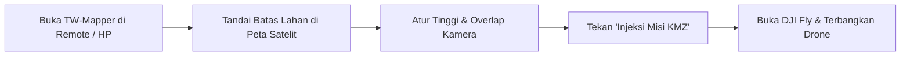

Selamat datang di panduan resmi **TW-Mapper Mobile**! 

Aplikasi ini dirancang khusus bagi Anda—para pilot drone, surveyor lapangan, pengelola perkebunan, dan praktisi pemetaan—yang ingin melakukan survei udara menggunakan drone DJI seri *consumer* (seperti **DJI Mini 4 Pro, Mini 5 Pro, Air 3, Air 3S, Mavic 3 Series, hingga Mavic 4 Pro**) langsung dari remote kontrol Anda.

---

## 🛑 Masalah Lapangan yang Kerap Dihadapi Pilot

Dahulu, pada drone DJI generasi lama (seperti Phantom 4 atau Mavic 2), pilot terbiasa menggunakan aplikasi otomatisasi seperti *DroneDeploy* atau *Dronelink*. 

Namun pada drone DJI keluaran terbaru:
1. **Dukungan SDK Pihak Ketiga Dihentikan**: DJI tidak lagi membuka akses kontrol otomatis untuk aplikasi pihak ketiga pada drone consumer terbaru. Pasar diarahkan ke drone lini Enterprise yang harganya jauh lebih tinggi.
2. **Ketergantungan Laptop di Kebun**: Pilot terpaksa merancang rute di laptop via web planner, mengekspor file KMZ, memindahkannya dengan kartu memori/kabel ke remote, baru bisa terbang.
3. **Kendala Jika Batas Lahan Berubah**: Jika di lokasi kerja patok batas tanah bergeser beberapa puluh meter atau terhalang pohon tinggi, rute tidak bisa diedit di lapangan karena laptop tertinggal di kantor.

---

## ⚡ Solusi TW-Mapper Mobile: Pemetaan Mandiri di Remote

TW-Mapper hadir untuk memangkas kerumitan tersebut:

> [!NOTE]
> *Gambar 1.1: Ekosistem survei udara mandiri TW-Mapper Mobile. Seluruh perancangan jalur terbang, kalibrasi sensor drone, hingga injeksi WPML dilakukan langsung di remote kontrol.*

- **100% Berjalan di Remote Kontrol**: Anda cukup membawa remote kontrol ke lapangan. Rancang poligon atau jalur koridor langsung di atas peta satelit.
- **Kamera Utama Terkalibrasi**: Karakteristik lensa wide utama, ukuran sensor, dan resolusi kamera dari 8 model drone DJI sudah tersimpan otomatis di dalam aplikasi.
- **Injeksi Langsung ke DJI Fly**: Sekali klik tombol *Injeksi*, file rute resmi DJI (WPML KMZ) langsung masuk ke memori DJI Fly. Drone siap terbang memotret secara otomatis.
- **Revisi Fleksibel di Lapangan**: Batas tanah bergeser? Cukup geser titik sudut di layar remote, tekan injeksi ulang, dan lanjutkan pemetaan dalam 30 detik!

---

## 🚁 Daftar Drone yang Didukung

Aplikasi telah terkalibrasi secara presisi untuk 8 model drone DJI:

| Seri Drone | Model | Karakteristik Utama di Lapangan |
| :--- | :--- | :--- |
| **Seri Mini** | **Mini 4 Pro**, **Mini 5 Pro** | Bobot super ringan (<249g), sangat senyap, ideal untuk area perumahan dan perkebunan terisolasi. |
| **Seri Air** | **Air 3**, **Air 3S** | Tahan hembusan angin kencang di pesisir/pegunungan, sensor 1 inci (Air 3S) menghasilkan foto sangat jernih. |
| **Seri Mavic** | **Mavic 3**, **Mavic 3 Classic**, **Mavic 3 Pro**, **Mavic 4 Pro** | Sensor besar format 4/3 Hasselblad, ketajaman ortofoto kelas profesional dengan detail tekstur tinggi. |

---

## 🎮 Remote Kontrol yang Kompatibel

1. **Remote Berlayar (Smart Controller)**:
   - **DJI RC 2** (`RM330`)
   - **DJI RC Pro** (`RM510`)
   Aplikasi dipasang langsung di dalam sistem Android remote.
2. **Remote Standar (Tanpa Layar)**:
   - **DJI RC-N1**, **RC-N2**, **RC-N3**
   Aplikasi dipasang pada smartphone atau tablet Android Anda yang dihubungkan ke remote via kabel USB bawaan.
