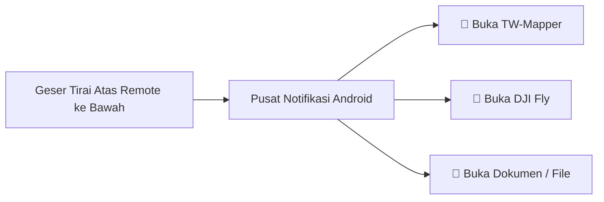

Bagi pilot yang menerbangkan drone menggunakan remote berlayar seperti **DJI RC 2** dan **DJI RC Pro**, Anda pasti pernah merasakan betapa repotnya berpindah aplikasi ketika **DJI Fly** sedang berjalan.

Aplikasi DJI Fly menutupi seluruh layar remote (*fullscreen mode*), sementara remote DJI tidak memiliki tombol fisik *Home* atau tombol *Recent Apps* seperti pada smartphone biasa. Pilot harus menggeser tepi layar berkali-kali hanya untuk keluar dari DJI Fly.

---

## ⚡ Solusi Praktis: Quick Navigator Helper

TW-Mapper Mobile secara otomatis mengaktifkan bilah kendali cepat di dalam menu tirai notifikasi Android remote Anda.

> [!NOTE]
> *Gambar 1.4: Tampilan tirai notifikasi Android remote DJI RC 2 saat DJI Fly sedang berjalan. (1) Tarik layar dari atas ke bawah, (2) Kartu notifikasi TW-Mapper Quick Navigator, dan (3) Tombol sakelar cepat untuk beralih aplikasi dalam 1 detik.*

### Cara Menggunakannya di Lapangan:
1. Saat sedang berada di dalam aplikasi DJI Fly, cukup **geser jari dari tepi paling atas layar remote ke arah bawah**.
2. Menu tirai notifikasi Android remote akan turun.
3. Anda akan melihat kartu notifikasi **TW-Mapper Quick Nav** dengan 3 tombol praktis:
   - **TW-Mapper**: Mengetuk tombol ini akan membawa Anda kembali ke aplikasi TW-Mapper seketika tanpa menutup DJI Fly.
   - **DJI Fly**: Mengetuk tombol ini akan mengembalikan Anda ke kamera DJI Fly untuk mengeksekusi misi.
   - **Documents / File**: Membuka pengelola file internal remote jika Anda ingin memeriksa file secara visual.
4. Sentuh salah satu tombol, dan Anda langsung berpindah aplikasi dalam **1 detik**!

---

## 💡 Mengapa Fitur Ini Begitu Disukai Pilot?

- **Misi Tidak Pernah Tertutup**: Karena aplikasi tidak di-*force close*, form rute lahan dan titik-titik koordinat yang Anda tandai di TW-Mapper tetap aman dan tidak hilang.
- **Transisi Mulus**: Setelah menekan tombol *Injeksi Misi* di TW-Mapper, Anda cukup turunkan notifikasi, ketuk tombol *DJI Fly*, dan langsung mulai terbang.
- **Eksklusif Mode RC**: Fitur ini aktif otomatis khusus di remote DJI RC 2 / RC Pro, dan tidak akan mengganggu pengguna smartphone Android biasa.
