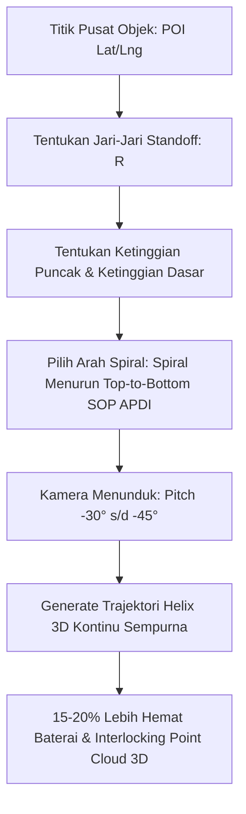

Sebagai platform perencanaan misi yang terus berkembang pesat, TW-Mapper-Mobile mengadopsi fitur-fitur kelas enterprise dari **DJI Pilot 2** serta standar operasional prosedur (SOP) inspeksi vertikal dari **Asosiasi Pilot Drone Indonesia (APDI Pusat)**.

---

## 🌀 1. Misi Orbit Helix 3D (Continuous Spiral / Pola "Per")

Dikembangkan bersama **Rwanda (WanDrone)**, **Aditiya Rachmat (Throttle Warrior)**, dan diperkaya masukan praktisi lapangan **Om Bahrun (APDI Pusat)** untuk inspeksi vertikal struktur tinggi (tower BTS, pilar jembatan, cerobong, tiang monopole, kubah gedung, dan monumen).

> [!NOTE]
> *Gambar: Parameter trajektori Continuous Spiral Helix 3D pada TW-Mapper Mobile untuk inspeksi struktur vertikal bertingkat.*

### Keunggulan Trajektori Helix Dibanding Orbit Cincin Biasa:
1. **Kecepatan 3D Konstan**: Drone bergerak mulus membentuk kurva pegas ("per") tanpa deselerasi di setiap pergantian lantai, menghemat konsumsi baterai 15% – 20%.
2. **SOP Spiral Menurun (*Top-to-Bottom*)**: Pilot memulai misi dari puncak menara lalu turun melingkar. Alur ini menjamin drone bebas dari risiko tersangkut kawat seling (*guy wires*), mengoptimalkan baterai, dan menjaga orientasi visual drone tetap jelas.
3. **Kamera Menunduk (*Pitch Down -30° s/d -45°*)**: Menghindari pemotretan latar belakang langit dan awan bergerak yang dapat memicu *noise floating points* pada hasil 3D mesh di Pix4D, DJI Terra, atau Metashape.
4. **Demokratisasi Fitur Enterprise**: Menghadirkan kemampuan inspeksi *Smart Oblique* sekelas Matrice 300/350 RTK pada drone consumer (DJI Air 3, Mini 4 Pro, Mavic 3 Series).

---

## 🏢 2. Adopsi 5 Fitur Enterprise DJI Pilot 2

Untuk menjembatani kebutuhan pilot komersial yang menerbangkan drone seri consumer di aplikasi DJI Fly, TW-Mapper-Mobile mengintegrasikan 5 fitur andalan dari DJI Pilot 2:

| No | Fitur Enterprise | Deskripsi & Kegunaan Lapangan |
| :--- | :--- | :--- |
| **1** | **Elevation Profile 2D** | Grafik irisan penampang ketinggian kontur tanah (Copernicus DEM 30m) di bawah rute terbang drone. Menampilkan garis elevasi tanah, lintasan drone, dan jarak bebas rintangan (*obstacle clearance margin*). |
| **2** | **Oblique & Gimbal Modes** | Preset sudut cepat (`-90° Nadir`, `-60° Oblique`, `-45° Fasad`) dengan kontrol haluan drone fleksibel (*Follow Wayline*, *Fixed Heading*, *POI Center Lock*). |
| **3** | **Breakpoint Resume Generator** | Pembuatan berkas misi lanjutan secara instan saat drone harus mendarat darurat atau mengganti baterai di tengah misi. Misi dapat dilanjutkan dari waypoint terputus tanpa mengulang dari awal. |
| **4** | **RTH Altitude Advisor** | Analisis otomatis titik elevasi tertinggi di sepanjang jalur misi untuk merekomendasikan ketinggian *Return-to-Home* (RTH) yang aman di DJI Fly, mencegah risiko tabrakan saat sinyal terputus (*failsafe*). |
| **5** | **Asymmetrical Corridor Buffer** | Pengaturan lebar buffer koridor yang independen antara sayap kiri (*left width*) dan sayap kanan (*right width*), sangat ideal untuk pemetaan jalan raya di tepi tebing, garis pantai, atau batas konsesi hutan. |

---

## 💻 Antarmuka Lanskap Optimal (GCS UI)

Seluruh komponen fitur enterprise ini dirancang khusus untuk layar lanskap remote controller (seperti DJI RC 2 dan DJI RC Pro), memanfaatkan ruang horizontal secara proporsional antara peta interaktif dan sidebar parameter misi.
