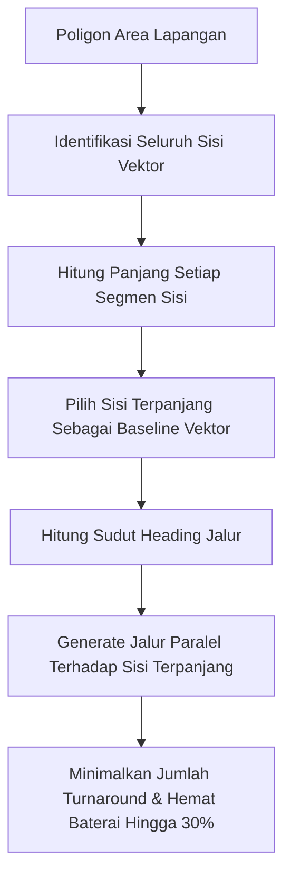

Pola pemindaian **Boustrophedon** (berasal dari bahasa Yunani kuno yang menggambarkan gerakan sapi saat membajak sawah bolak-balik) adalah standar emas dalam survei fotogrametri udara ortofoto 2D.

Dalam TW-Mapper-Mobile, pembuatan grid boustrophedon tidak dilakukan secara statis dengan orientasi utara-selatan, melainkan menggunakan algoritma orientasi cerdas **Efficient Longest-Edge Alignment**.

---

## 🧭 Algoritma Longest-Edge Alignment

Setiap kali drone berputar 180° di ujung jalur penerbangan (*turnaround waypoint*), drone harus melakukan perlambatan (*deceleration*), rotasi yaw, akselerasi kembali, dan menstabilkan gimbal. Proses ini menghabiskan daya baterai 15–25% lebih banyak dibandingkan terbang lurus dengan kecepatan konstan.

> [!NOTE]
> *Gambar: Implementasi algoritma Longest-Edge Alignment pada TW-Mapper Mobile. Rute penerbangan secara otomatis diputar agar sejajar dengan sisi batas kebun terpanjang.*

Dengan menyelaraskan jalur penerbangan sejajar dengan sisi terpanjang poligon, TW-Mapper meminimalkan jumlah lajur penerbangan dan memangkas jumlah manuver putaran hingga **30%**, sehingga area yang dapat dipetakan dalam 1 baterai menjadi jauh lebih luas.

---

## 📊 Parameter Grid Boustrophedon

| Parameter | Deskripsi | Rekomendasi Lapangan |
| :--- | :--- | :--- |
| **Ketinggian ($H$)** | Ketinggian drone di atas permukaan tanah (AGL) | 60 m – 120 m (sesuai target GSD) |
| **Frontlap** | Persentase overlap foto searah jalur terbang | 75% – 85% |
| **Sidelap** | Persentase overlap antar jalur paralel bersebelahan | 65% – 75% |
| **Jalur Masuk/Keluar** | Titik mulai (*Start Waypoint*) terdekat dengan pilot | Otomatis dihitung terdekat |
| **Tindakan Selesai** | Aksi drone setelah titik akhir dicapai | Kembali ke Home Point (RTH) / Hover |

---

## 🧮 Rumus Kalkulasi Ground Sampling Distance (GSD)

Resolusi pixel di darat dihitung secara real-time berdasarkan spesifikasi sensor kamera yang dipilih:

$$\text{GSD} = \frac{H \times S_w}{F \times I_w} \times 100 \quad (\text{cm/pixel})$$

Di mana:
- $H$ = Ketinggian terbang rencana (meter)
- $S_w$ = Lebar fisik sensor kamera (mm)
- $F$ = Panjang fokus lensa / focal length (mm)
- $I_w$ = Resolusi piksel lebar gambar (pixel)

TW-Mapper-Mobile memperbarui angka GSD ini secara instan begitu slider ketinggian atau model drone diubah oleh pilot.
