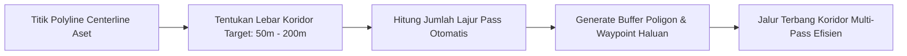

Survei fotogrametri pada aset infrastruktur linear seperti jalan tol, rel kereta api, jalur transmisi listrik tegangan tinggi (SUTET), pipa minyak/gas, dan daerah aliran sungai (DAS) memiliki tantangan unik:
1. Objek membentang panjang berliku-liku dengan lebar terbatas.
2. Menggunakan grid poligon biasa akan memboroskan baterai karena drone menerbangi area kosong di luar koridor.
3. Terowongan angin atau medan elevasi bervariasi membutuhkan margin batas (*buffer zone*) yang presisi.

---

## 🛣️ Fitur Misi Koridor TW-Mapper

Mode Koridor di TW-Mapper-Mobile memungkinkan pilot membuat garis tengah (*centerline*) aset yang berliku, kemudian menentukan lebar koridor yang diinginkan. Sistem secara otomatis menyusun jalur terbang multi-pass dengan kalkulasi sidelap yang sempurna.

> [!NOTE]
> *Gambar: Perancangan misi linear koridor jalan di TW-Mapper Mobile. Jalur terbang bolak-balik membentang konsisten di dalam zona penyangga (buffer width).*

### Karakteristik Utama:
- **Centerline Polyline Input**: Cukup sentuh beberapa titik belokan pada peta mengikuti jalur jalan atau kabel transmisi.
- **Lebar Koridor Dinamis**: Atur lebar koridor mulai dari 20 meter hingga 500 meter.
- **Multi-Line Pass Otomatis**:
  - *Single Pass (1 Line)*: Cocok untuk inspeksi visual cepat atau koridor sempit (<30m).
  - *Double Pass (2 Lines)*: Memberikan sudut pandang ganda untuk mendeteksi tiang/pilar.
  - *Multi Pass (3+ Lines)*: Memberikan overlap sidelap 65%+ untuk rekonstruksi DTM/DSM koridor penuh.
- **Sudut Belokan Halus (Curved Waypoint Turning)**: Menghasilkan belokan melengkung halus di setiap simpul koridor sehingga drone tidak berhenti mendadak, menghemat energi hingga 20%.

---

## 📋 Rekomendasi Pengaturan Koridor

| Jenis Aset Survei | Lebar Koridor Rencana | Jumlah Lajur (Pass) | Rekomendasi Ketinggian ($H$) |
| :--- | :--- | :--- | :--- |
| **Jalan Raya / Tol** | 60 – 100 meter | 2 – 3 Pass | 70 – 90 meter |
| **Transmisi SUTET** | 40 – 80 meter | 2 Pass (kiri & kanan kawat) | 15 – 25 meter di atas puncak kawat |
| **Jalur Pipa Migas** | 30 – 60 meter | 2 Pass | 50 – 70 meter |
| **Aliran Sungai / Kanal** | 100 – 250 meter | 3 – 5 Pass | 80 – 120 meter |

> [!TIP]
> Pastikan untuk menaikkan nilai Frontlap ke **80%** pada misi koridor jalan beraspal atau permukaan air sungai guna memastikan perangkat lunak fotogrametri (seperti Agisoft Metashape, PIX4D, atau OpenDroneMap) dapat menemukan titik *tie points* yang cukup pada tekstur yang seragam.
