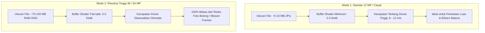

Salah satu kegagalan paling fatal dalam survei fotogrametri udara menggunakan drone modern (seperti DJI Air 3, Mini 4 Pro, atau Mavic 3) adalah fenomena **"Foto Bolong" (Missed Frames)**.

Ketika drone diterbangkan terlalu cepat pada ketinggian rendah dengan target overlap tinggi, kamera DJI gagal memotret sejumlah waypoint karena buffer penyimpanan internal microSD masih sibuk menulis (*write buffer full*). Akibatnya, peta ortofoto yang dihasilkan memiliki lubang besar dan proyek survei harus diulang total dari awal di lapangan.

Untuk mengatasi ini, **WanDrone Palembang** merumuskan standar fotogrametri ketat yang ditanamkan secara mendalam pada TW-Mapper-Mobile.

---

## 📷 1. Penguncian Kamera Wide Utama (~24mm eq)

Drone modern DJI seperti *Air 3*, *Air 3S*, dan *Mavic 3 Pro* dilengkapi sistem kamera ganda atau tripel (Wide, Medium Tele 70mm, Tele 166mm).

TW-Mapper-Mobile **secara eksklusif mengunci seluruh perhitungan fotogrametri pada kamera Wide utama (~24mm eq)**:
- Sudut pandang (*Field of View*) terlebar menghasilkan cakupan luas per foto.
- Bebas dari distorsi kompresi perspektif yang sering merusak kalibrasi bundle adjustment pada lensa tele.
- Bukaan diafragma fisik terbesar (f/1.7 s/d f/2.8) memaksimalkan tangkapan cahaya saat cuaca berawan.

---

## ⏱️ 2. Ambang Batas Dual-Resolusi Sensor

Ukuran data foto menentukan seberapa cepat prosesor kamera dapat menyelesaikan penulisan ke kartu microSD:

### Matriks Ambang Batas Sensor:
1. **Mode 12 MP (Standar / Cepat)**:
   - Interval rana minimum hardware: $T_{\min} = 2.0\text{ detik}$.
   - Cocok untuk survei cepat, pemetaan topografi umum, dan proyek perkebunan luas.
2. **Mode 48 MP / 50 MP (High-Res / RAW DNG)**:
   - Interval rana fail-safe: $T_{\min} = 5.0\text{ detik}$.
   - Wajib digunakan saat pilot mengaktifkan penyimpanan format RAW DNG resolusi penuh untuk survei batas kadastral BPN atau inspeksi detail tinggi.
3. **Sensor Native Khusus**:
   - DJI Mavic 3 Series (20 MP Hasselblad CMOS 4/3) & Mavic 4 Pro (25 MP) langsung terkunci pada resolusi native optimalnya dengan buffer aman $T_{\min} = 2.0\text{ detik}$.

---

## 🧮 3. Dynamic Speed Clamping

Untuk mencegah pilot salah mengatur kecepatan di lapangan, TW-Mapper menghitung kecepatan terbang maksimum yang aman secara real-time:

$$V_{\text{safe\_max}} = \frac{D_{\text{foto}}}{T_{\min}}$$

Di mana:
- $D_{\text{foto}}$ = Jarak terbang fisik antar jepretan foto berurutan (meter), dihitung dari ketinggian $H$ dan persentase Frontlap.
- $T_{\min}$ = Batas interval waktu rana kamera (2.0s untuk 12 MP; 5.0s untuk 48/50 MP).

### Cara Kerja Pemotongan Slider:
Jika pilot memilih ketinggian rendah ($H = 40\text{ meter}$) dengan frontlap rapat ($80\%$), maka jarak antar foto menjadi sangat dekat ($D_{\text{foto}} \approx 8\text{ meter}$).
- Pada mode 48 MP ($T_{\min} = 5.0\text{s}$), kecepatan maksimum aman adalah:
  $$V_{\text{safe\_max}} = \frac{8\text{ m}}{5.0\text{ s}} = 1.6\text{ m/s}$$
- TW-Mapper akan **secara otomatis memotong batas atas slider kecepatan** ke $1.6\text{ m/s}$.
- Jika sebelumnya pilot mengatur kecepatan pada $10\text{ m/s}$, angka tersebut langsung diturunkan (*auto-throttled*) ke $1.6\text{ m/s}$.

> [!NOTE]
> *Gambar: Jendela edukasi Why Speed Clamped pada TW-Mapper Mobile yang merincikan perhitungan formula $V_{\text{safe\_max}}$ secara transparan kepada pilot.*

---

## 💡 Dialog Edukasi Pilot: "Mengapa Kecepatan Dibatasi?"

Ketika sistem melakukan *clamping*, sebuah ikon peringatan informatif akan muncul. Mengetuk ikon tersebut akan membuka dialog **WhySpeedClampedDialog** yang menjelaskan kondisi teknis secara transparan beserta **3 Solusi Instan untuk Terbang Lebih Cepat**:

1. **Naikkan Ketinggian Terbang ($H$)**: Menaikkan ketinggian akan memperlebar jejak foto di tanah (*ground footprint*), sehingga jarak antar foto bertambah besar dan drone dapat melaju lebih kencang.
2. **Turunkan Frontlap**: Menyesuaikan frontlap dari 85% ke 75% memperpanjang jarak $D_{\text{foto}}$ tanpa mengurangi kualitas mosaik ortofoto pada area datar.
3. **Ganti ke Mode 12 MP**: Mengalihkan sensor dari mode 48 MP ke 12 MP langsung memangkas waktu tunggu buffer dari 5.0 detik menjadi 2.0 detik, meningkatkan batas kecepatan aman lebih dari $2.5\times$ lipat.
