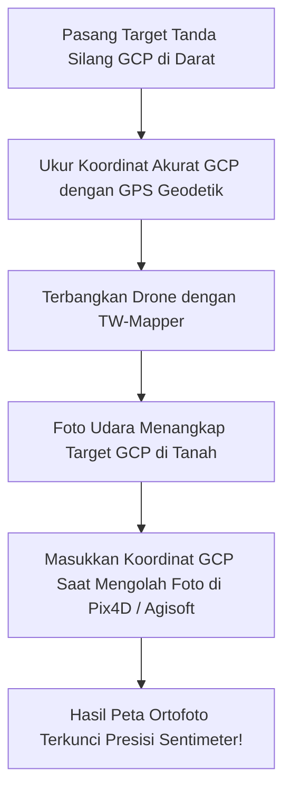

Banyak pilot dan pemilik proyek bertanya: *"Apakah drone consumer DJI (seperti Mini 4 Pro, Air 3, atau Mavic 3) bisa menghasilkan peta dengan akurasi sentimeter untuk keperluan sertifikat tanah atau teknik sipil?"*

Jawabannya: **Bisa, asalkan Anda memahami peran GPS navigasi dan menggunakan titik kontrol tanah (Ground Control Points / GCP).**

---

## 🧭 Memahami Karakteristik GPS Drone Consumer

Drone DJI kelas consumer menggunakan modul GPS navigasi standar (kompatibel GPS, GLONASS, Galileo, BeiDou):
- **Akurasi Posisi Horizontal Bawaan**: Berkisar antara **$1\text{ hingga }3\text{ meter}$**.
- Drone ini tidak memiliki modul RTK internal sekelas Matrice 350 RTK atau Phantom 4 RTK yang harganya puluhan juta rupiah lebih mahal.

### Kapan Akurasi Bawaan GPS Sudah Cukup?
Untuk pekerjaan berikut, akurasi GPS bawaan ($1\text{–}3\text{ meter}$) sudah sangat memadai tanpa memerlukan GCP:
- Sensus dan penghitungan jumlah pohon kelapa sawit.
- Estimasi luasan lahan kebun atau sawah perkiraan.
- Monitoring progres pembangunan proyek mingguan.
- Dokumentasi foto udara lingkungan hidup atau bencana alam.

---

## 📐 Kapan Wajib Menggunakan Titik Kontrol Tanah (GCP)?

Jika pekerjaan Anda menuntut **toleransi kesalahan di bawah 5 centimeter** (seperti pengukuran batas tanah kadaster BPN, perencanaan cut-and-fill tambang, atau rekayasa jalan tol):

Anda wajib memasang patok target **GCP (Ground Control Points)** di darat yang diukur menggunakan **GPS Geodetik / GNSS RTK** di darat.

> [!NOTE]
> *Gambar 3.4: SOP sebaran titik Ground Control Points (GCP). (1) Pemasangan 4 target di sudut terluar batas lahan, (2) Titik GCP di pusat lahan, dan (3) Pengukuran koordinat presisi tinggi menggunakan GNSS RTK Geodetik.*

---

## 💡 Panduan Memasang GCP di Lapangan

1. **Bentuk Target yang Jelas**: Buat tanda silang atau papan catur hitam-putih berukuran minimal $50\text{ cm} \times 50\text{ cm}$ (atau terpal khusus target GCP) yang kontras dengan warna rumput/tanah.
2. **Sebarkan Merata di Seluruh Lahan**:
   - Pasang target di ke-4 sudut terluar batas lahan.
   - Pasang 1–2 target di bagian tengah lahan.
   - *Rasio umum*: Minimal 5 titik GCP untuk lahan seluas 10–20 hektar.
3. **Bebas Hambatan Pohon**: Pastikan target GCP terlihat jelas dari udara dan tidak tertutup bayangan pohon atau atap seng.

Dengan metode ini, drone DJI kelas consumer seharga belasan juta rupiah mampu menghasilkan data pemetaan dengan akurasi setara drone enterprise ratusan juta rupiah!
