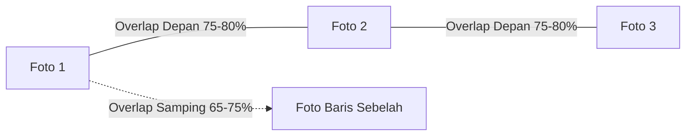

Bagi pilot yang baru memulai pemetaan udara, tiga istilah ini adalah pondasi paling penting: **Ketinggian ($H$)**, **GSD (Resolusi Tanah)**, dan **Overlap (Tumpang Tindih Foto)**.

---

## 🔍 Apa Itu GSD (Ground Sampling Distance)?

**GSD** adalah ukuran fisik di dunia nyata yang diwakili oleh satu buah piksel di dalam foto Anda. Biasanya diukur dalam satuan **cm/pixel**.

- Contoh: Jika sebuah foto memiliki GSD **2 cm/pixel**, artinya satu buah piksel pada gambar tersebut mewakili kotak ukuran $2\text{ cm} \times 2\text{ cm}$ di atas tanah.
- **Makin kecil angka GSD**: Foto makin detail dan tajam. Patok batas tanah, kabel, atau saluran pipa kecil akan terlihat sangat jelas.
- **Makin besar angka GSD**: Detail foto makin kasar. Cocok untuk estimasi luasan area besar seperti perkebunan ribuan hektar.

### Tabel Perkiraan GSD Berdasarkan Ketinggian (DJI Air 3):

| Ketinggian Terbang ($H$) | Resolusi Tanah (GSD) | Kesesuaian Pekerjaan |
| :--- | :--- | :--- |
| **50 meter** | $\approx 1.3\text{ cm/pixel}$ | Pengukuran batas patok BPN, konstruksi sipil, inspeksi detail jembatan. |
| **80 meter** | $\approx 2.1\text{ cm/pixel}$ | Standar emas pemetaan perkebunan, topografi perumahan, dan tambang. |
| **100 meter** | $\approx 2.7\text{ cm/pixel}$ | Pemetaan cepat area luas, inventarisasi vegetasi, sensus pohon kelapa sawit. |
| **120 meter** | $\approx 3.2\text{ cm/pixel}$ | Survei koridor jalan panjang, daerah aliran sungai (DAS). |

---

## 📷 Mengapa Overlap Foto Sangat Penting?

Perangkat lunak fotogrametri (seperti Agisoft Metashape, Pix4D, DJI Terra, atau WebODM) membutuhkan titik-titik kesamaan tekstur (*tie points*) yang muncul di beberapa foto sekaligus untuk menyambung ratusan foto menjadi satu peta utuh.

> [!NOTE]
> *Gambar 3.2: Standar fotogrametri udara. (1) Pengaruh ketinggian terbang $H$ terhadap luas jejak foto, (2) Persentase Frontlap 80% searah terbang drone, (3) Resolusi detail piksel tanah (GSD), dan (4) Kerapatan Sidelap 70% antar lajur.*

### Rekomendasi Pengaturan Overlap di TW-Mapper:
1. **Frontlap (Overlap Depan / Searah Terbang)**:
   - *Area Normal (Perumahan / Tanah Terbuka)*: **75%**.
   - *Area Sulit (Vegetasi Rimbun / Kebun Sawit / Hutan)*: **80%**.
   - *Permukaan Seragam (Aspal Jalan / Air Sungai)*: **80% – 85%**.
2. **Sidelap (Overlap Samping / Antar Baris)**:
   - *Area Normal*: **65% – 70%**.
   - *Area Berbukit / Pohon Tinggi*: **70% – 75%**.

> [!TIP]
> Jangan mengatur overlap terlalu kecil (misal di bawah 60%) karena software akan gagal menyambung foto (*stitching failure*) dan peta Anda akan robek atau terdistorsi!
