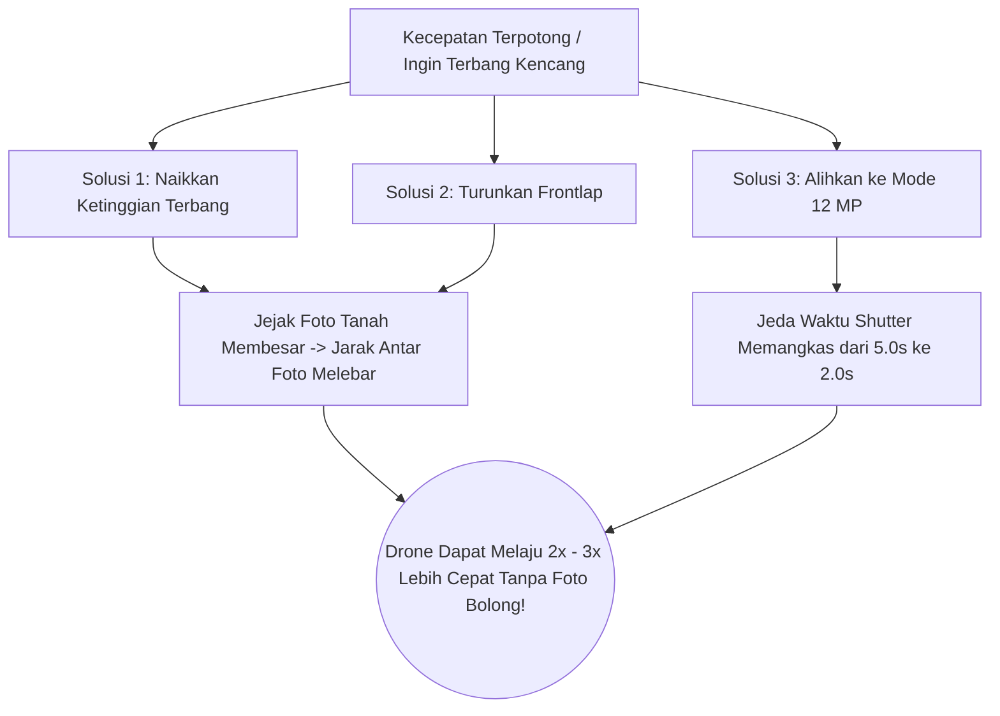

Pernahkah Anda memetakan area luas, lalu setelah kembali ke kantor dan memeriksa isi kartu memori MicroSD, ternyata ada lajur terbang yang **fotonya bolong-bolong atau terlewat puluhan foto**?

Kondisi tersebut dinamakan **Missed Frames (Foto Bolong)**. Penyebab utamanya bukan karena drone rusak, melainkan karena **drone dipaksa terbang terlalu cepat pada ketinggian rendah**, sehingga kamera DJI belum selesai menyimpan foto sebelumnya saat titik foto berikutnya sudah terlewati.

---

## 🛑 Mengapa Kecepatan Dibatasi Otomatis (Dynamic Speed Clamping)?

TW-Mapper Mobile menanamkan algoritma proteksi **Dynamic Speed Clamping**:

$$V_{\text{safe\_max}} = \frac{D_{\text{foto}}}{T_{\min}}$$

- $D_{\text{foto}}$ = Jarak fisik antar foto di udara (dihitung dari ketinggian $H$ dan persentase Frontlap).
- $T_{\min}$ = Waktu jeda minimum penyimpanan kamera ($2.0\text{ detik}$ untuk 12 MP; $5.0\text{ detik}$ untuk 48 MP).

Jika Anda terbang rendah ($H = 40\text{ m}$) dengan frontlap rapat ($80\%$), maka jarak antar jepretan foto menjadi sangat dekat ($D_{\text{foto}} \approx 8\text{ meter}$).
- Jika Anda menggunakan mode 48 MP ($T_{\min} = 5\text{ detik}$), maka kecepatan maksimal yang aman hanyalah:
  $$\frac{8\text{ meter}}{5\text{ detik}} = 1.6\text{ m/s}$$
- TW-Mapper akan **langsung memotong batas slider kecepatan** ke $1.6\text{ m/s}$ agar kamera drone tidak pernah menolak memotret!

> [!NOTE]
> *Gambar 3.1: Dialog edukatif Why Speed Clamped WanDrone. Menjelaskan secara transparan batas waktu minimum jeda shutter hardware kamera dan kecepatan terbang maksimal yang aman untuk mencegah foto terlewat (missed frames).*

---

## 🚀 3 Solusi Instan Jika Ingin Drone Terbang Lebih Cepat

Jika slider kecepatan terpotong dan Anda ingin drone terbang lebih kencang agar survei cepat selesai, Anda memiliki **3 solusi instan**:

1. **Naikkan Ketinggian Terbang ($H$)**:
   Jika Anda menaikkan ketinggian dari 40m menjadi 80m, jejak foto di tanah membesar $2\times$ lipat. Jarak antar foto menjadi lebih renggang, sehingga drone dapat melaju dua kali lebih kencang.
2. **Turunkan Frontlap**:
   Sesuaikan overlap depan dari 85% menjadi 75%. Ini menambah jarak tempuh antar bidikan tanpa mengurangi kualitas penyambungan foto di area datar.
3. **Ganti ke Mode 12 MP**:
   Jika Anda sedang berada di mode 48 MP, ubahlah ke mode 12 MP. Waktu tunggu penyimpanan kamera seketika turun dari 5 detik menjadi 2 detik. Drone Anda langsung diizinkan terbang kencang hingga $8\text{ – }12\text{ m/s}$!
