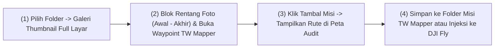

Fitur **Audit Foto** (terletak di menu **Fitur** tepat di bawah **Laporan**) berjalan **100% terisolasi di dalam jendelanya sendiri** sehingga sama sekali tidak mengganggu atau mengubah proyek yang sedang terbuka di Peta Utama TW-Mapper.

---

## Alur Kerja Audit Foto

> [!NOTE]
> *Gambar 5.5: Tampilan Galeri Foto Thumbnail Full-Layar pada fitur Audit Foto. (1) Tombol Waypoint TW Mapper & Peta Audit, (2) Grid Thumbnail Foto Udara dengan fitur Blok Kolektif Awal - Akhir, dan (3) Tombol Tambal Misi.*

---

## 4 Langkah Menggunakan Audit Foto

### 1. Buka "Audit Foto" & Pilih Folder Foto
1. Ketuk menu **Fitur** di bilah atas TW-Mapper, lalu pilih **"Audit Foto"** (berada tepat di bawah menu *Laporan*).
2. Tekan **`Pilih Folder Foto`** dan arahkan ke folder foto drone Anda (misal `DCIM/100MEDIA`).
3. Layar akan menampilkan **Galeri Foto Full-Layar dengan Thumbnail** setiap foto, nomor urut (`#1`, `#2`, ...), nama file, serta ketinggian terbangnya.

### 2. Blok Rentang Foto (`Blok Awal - Akhir`) & Buka Waypoint TW Mapper
- **Blok Kolektif (`Blok Awal - Akhir`):** Ketuk thumbnail **Foto Awal** (muncul label `AWAL #X`), lalu ketuk thumbnail **Foto Akhir**. Seluruh foto di rentang tersebut langsung terblok sekaligus.
- **Samakan dengan Waypoint Misi TW Mapper:** Tekan tombol **`Waypoint TW`** di bilah atas untuk memilih misi yang tersimpan di **Folder Misi TW Mapper** (atau menyalin secara *read-only* waypoint yang sedang aktif). TW-Mapper akan menyamakan hasil foto aktual dengan perencanaan jalur tersebut.

### 3. Periksa Titik Foto & Overlap di Peta Audit
Tekan tombol **`Buka Peta Audit`** (atau tombol **`Peta Audit`** di bilah atas):
- **`Titik Foto`**: Menampilkan/menyembunyikan titik nomor urut GPS foto di atas peta satelit.
- **`Overlap`**: Menampilkan/menyembunyikan kotak tapak foto (Hijau = Aman, Kuning = Tipis/Blur, Merah `X` = Bolong) beserta garis kuning jalur Waypoint TW Mapper.

### 4. Tampilkan Rute Tambal Misi di Peta Audit Sebelum Simpan / Injeksi
1. Jika terdapat titik bolong, tekan tombol **`Tambal Misi`** di pojok kanan atas.
2. Rute tambalan berwarna biru muda (*Cyan*) akan **ditampilkan terlebih dahulu di atas Peta Audit** agar Anda dapat meninjau jalurnya.
3. Setelah rute tambalan tampil di peta, dua tombol interaktif akan muncul di bilah atas:
   - **`Simpan`**: Menyimpan berkas `PATCH_<NamaMisi>.kmz` langsung ke **Folder Misi TW Mapper**.
   - **`Injeksi`**: Membuka jendela Injeksi untuk menyuntikkan berkas `PATCH_<NamaMisi>.kmz` ke DJI Fly tanpa mengubah misi di Peta Utama aplikasi.
