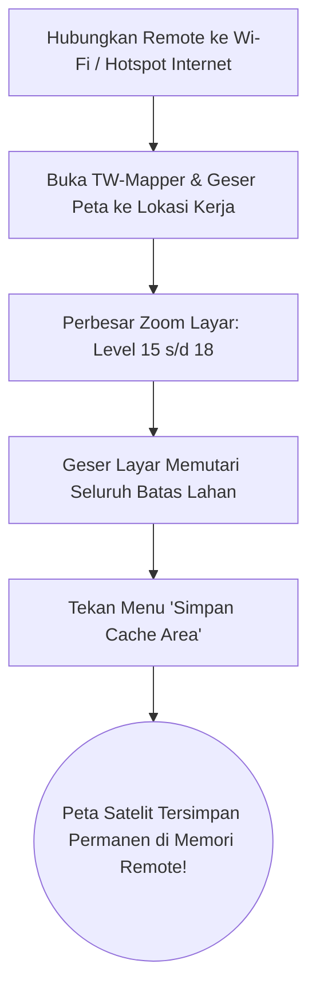

Sebagian besar lokasi survei fotogrametri drone berada di kawasan pedalaman, area perkebunan sawit terpencil, atau area pertambangan yang sama sekali **tidak memiliki jangkauan sinyal internet seluler (blank spot)**.

Jika Anda baru membuka peta saat tiba di lokasi tanpa internet, layar peta akan berwarna abu-abu kosong karena remote tidak dapat mengunduh citra satelit.

---

## 📥 Cara Mengunduh Peta Offline Sebelum Berangkat

Lakukan langkah sederhana ini saat Anda masih berada di rumah, hotel, atau kantor yang memiliki koneksi Wi-Fi:

> [!NOTE]
> *Gambar 5.2: Tampilan antarmuka pengunduh peta satelit offline. (1) Pilih area kota/kebun, (2) Batas ketajaman zoom level, dan (3) Progres unduhan ubin peta satelit ke MicroSD untuk operasi tanpa sinyal internet.*

1. **Sambungkan Remote ke Internet**: Nyalakan Wi-Fi di remote DJI RC 2 / RC Pro Anda atau aktifkan hotspot tethering dari HP.
2. **Buka TW-Mapper**: Arahkan dan geser peta ke koordinat area kerja yang akan Anda petakan besok.
3. **Perbesar Layar (*Zoom In*)**: Perbesar tampilan peta hingga tingkat detail tinggi (level zoom 16–18) di mana pohon, jalan tanah, dan atap rumah terlihat jelas.
4. **Jelajahi Seluruh Area Lahan**: Geser layar secara perlahan menyusuri seluruh batas area proyek. TW-Mapper secara otomatis menyimpan setiap ubin citra satelit (*map tiles*) yang Anda lihat ke dalam memori penyimpanan internal (*local cache*).
5. **Simpan Permanen**: Buka menu peta di sisi kiri, pilih opsi **"Simpan Cache Area Ini"**.

---

## 🌲 Kesiapan di Lapangan Tanpa Sinyal

Kini, saat Anda tiba di tengah hutan atau kebun tanpa sinyal internet:
- Nyalakan remote kontrol Anda.
- Buka TW-Mapper: Seluruh citra satelit resolusi tinggi tetap tampil jernih dan tajam 100%!
- Anda dapat menandai batas patok lahan, memposisikan waypoint, dan mengekspor misi fotogrametri dengan sangat nyaman.
