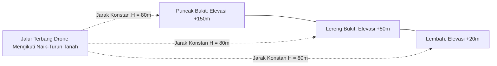

Jika Anda memetakan area yang datar (seperti persawahan atau pesisir pantai), terbang dengan ketinggian konstan di atas titik lepas landas (*Home Point Altitude*) sudah cukup.

Namun jika lahan memiliki bukit tinggi, jurang, atau lereng bergelombang:
1. **Risiko Tabrakan**: Jika drone terbang datar dari lembah menuju bukit, drone dapat menabrak puncak bukit.
2. **Perbedaan Resolusi Foto**: Foto di puncak bukit akan sangat dekat (GSD kecil), sementara foto di lembah akan sangat jauh (GSD besar), membuat hasil mosaik ortofoto tidak seragam.

---

## ⛰️ Solusi Terrain Follow di TW-Mapper

TW-Mapper Mobile membaca data elevasi permukaan bumi digital (**Digital Elevation Model / DEM Copernicus 30m**) untuk menghitung profil ketinggian setiap waypoint secara otomatis.

> [!NOTE]
> *Gambar 2.7: Perbandingan profil ketinggian terbang. (1) Jalur Terrain Follow menjaga jarak vertikal $H = 80\text{m}$ selalu konstan di atas tanah, (2) Drone otomatis naik melintasi punggung bukit untuk mencegah tabrakan, dan (3) Data elevasi dihitung otomatis berbasis DEM Copernicus 30m.*

### Keuntungan Utama:
- **Jarak Kamera ke Tanah Selalu Sama**: Jika Anda mengatur ketinggian $H = 80\text{ meter}$, drone akan otomatis naik saat melewati bukit dan turun saat melewati lembah, sehingga jarak ke tanah selalu tepat 80 meter.
- **Resolusi Pixel (GSD) Konsisten**: Seluruh foto dari ujung utara hingga selatan memiliki ketajaman dan skala yang seragam.
- **Overlap Foto Stabil**: Persentase overlap depan dan samping tidak menyempit atau melebar secara liar akibat perubahan elevasi tanah.

---

## 💡 Tips Keselamatan Terbang di Area Berbukit

> [!WARNING]
> **Pilih Titik Lepas Landas (*Take-off Point*) yang Tinggi**:
> Sebisa mungkin lepas landaskan drone dari tempat yang relatif tinggi di area kerja Anda, bukan dari dasar lembah yang tertutup pepohonan rimbun. Hal ini memastikan sinyal radio remote ke drone tidak terhalang oleh punggung bukit (*Line of Sight* tetap terjaga).

> [!TIP]
> **Atur Ketinggian RTH (Return-to-Home) Lebih Tinggi dari Puncak Bukit**:
> Pastikan pengaturan ketinggian darurat RTH di DJI Fly diatur minimal **30–50 meter lebih tinggi daripada bukit tertinggi** di sekitar area pemetaan. Jika sinyal mendadak terputus, drone akan naik ke ketinggian aman tersebut sebelum terbang lurus kembali ke titik lepas landas.
