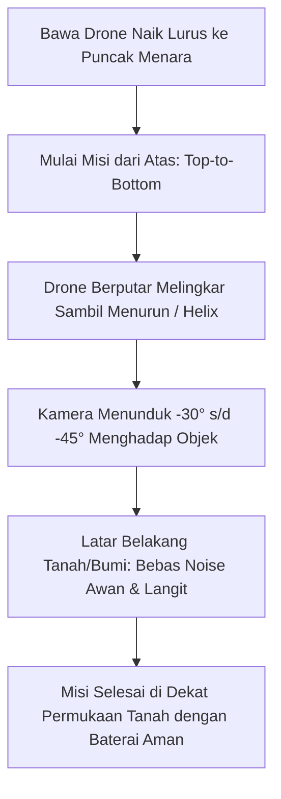

Memetakan atau menginspeksi struktur vertikal tinggi—seperti menara BTS telekomunikasi, pilar jembatan tinggi, cerobong pabrik, kubah masjid, atau monumen—memiliki tantangan keselamatan yang tinggi, terutama bahaya kawat seling pancang (*guy wires*).

TW-Mapper Mobile menyediakan fitur **Orbit Helix 3D (Continuous Spiral / Pola "Per")** yang dirancang berdasarkan Standar Operasional Prosedur (SOP) dari praktisi senior **Om Bahrun (APDI Pusat - Asosiasi Pilot Drone Indonesia)**.

---

## 🌀 Mengapa Pola Helix Lebih Unggul daripada Cincin Biasa?

Pada orbit bertingkat biasa (*cylindrical rings*), drone berhenti di setiap lantai lalu naik sedikit demi sedikit. Cara ini boros baterai dan pergerakan kameranya patah-patah.

Pada pola **Helix 3D**, drone berputar melingkar secara kontinu sambil turun perlahan seperti per pegas:
- **Hemat Baterai 15% – 20%**: Drone bergerak dengan kecepatan konstan tanpa lonjakan daya akselerasi/deselerasi.
- **Distribusi Foto Mengunci (*Interlocking Diagonal*)**: Posisi foto saling tumpang tindih secara diagonal, menghasilkan model 3D yang sangat rapat dan minim lubang.

---

## 🗼 SOP Keselamatan Lapangan Inspeksi Menara (APDI Pusat)

> [!NOTE]
> *Gambar 2.4: Perencanaan misi Orbit 3D Helix. (1) Titik pusat struktur menara (POI), (2) Jalur spiral melingkar turun kontinu bebas jeda, dan (3) Panel pengaturan radius aman serta rentang ketinggian top-to-bottom sesuai SOP APDI Pusat.*

### 1. Titik Awal Selalu dari Puncak (*Top-to-Bottom*)
Jangan pernah memulai spiral dari bawah menara lalu naik ke atas! Selalu mulai misi dari puncak struktur lalu melingkar turun ke bawah. 
- Di awal misi, baterai drone masih 100% penuh saat bermanuver di dekat puncak menara.
- Drone bebas dari risiko tersangkut bentangan kawat seling (*guy wires*) yang biasanya melebar ke arah bawah.

### 2. Kamera Wajib Menunduk (*Pitch Down -30° s/d -45°*)
Jangan menghadapkan kamera lurus mendatar ($0^\circ$). Kamera yang mendatar akan menangkap latar belakang langit dan awan bergerak, yang akan memicu bintik-bintik melayang (*noise floating points*) pada model 3D Anda. Menundukkan kamera memastikan latar belakang foto adalah tanah yang diam.

### 3. Jari-Jari Aman (*Standoff Distance*)
Atur radius jarak putaran drone minimal **15 hingga 25 meter** dari titik tengah menara untuk menjaga jarak aman dari antena sektoral maupun turbulensi angin di sekitar tiang.
