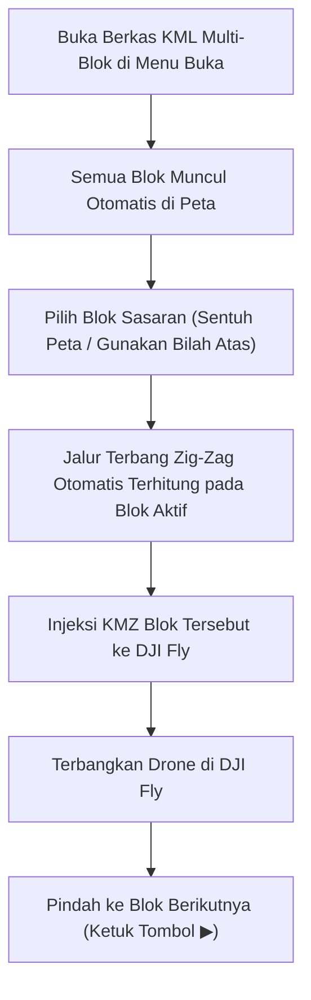

import { Tabs, TabItem } from '@astrojs/starlight/components';

Dalam operasi pemetaan perkebunan kelapa sawit, konsesi hutan tanaman industri (HTI), maupun wilayah pertambangan skala besar, batas wilayah kerja umumnya dibagikan oleh tim GIS kantor dalam satu berkas KML terpadu yang berisi **puluhan blok poligon terpisah** (contohnya berkas perkebunan `MUBA.kml` dengan 33 blok divisi seluas total 4.769 Hektar).

Mulai versi **v1.8.0**, **TW-Mapper Mobile** menghadirkan fitur **Multi-Area KML Workspace Engine**. Anda tidak perlu lagi memotong-motong file KML satu per satu di laptop sebelum berangkat ke kebun. Seluruh blok langsung terbaca sekaligus di layar remote controller Anda!

---

## 📋 Alur Kerja Multi-Area di Lapangan



---

## 🕹️ Mengenal Bilah Samping Khusus Blok Area & Indikator Minimalis

Untuk menjaga area kanvas peta satelit tetap luas, bersih, dan **100% bebas dari tumpang tindih (*zero overlap*)**, TW-Mapper menggunakan arsitektur antarmuka dua pilar:

### 1. Bilah Samping Khusus Blok Area (`[ 📑 BLOK > ]`)
Di sisi kiri tepi layar, kini terdapat tab pendamping yang sejajar dengan tab parameter:
- **`[ PARAMETER > ]`**: Membuka pengaturan ketinggian, kecepatan, overlap, dan kamera.
- **`[ 📑 BLOK (N) > ]`**: Membuka **Bilah Samping Khusus Blok Area (Multi-Area Panel)**.

```
┌────────────────────────────────┐
│  ▶ PARAMETER                   │
├────────────────────────────────┤
│  ▶ 📑 BLOK (1/33)              │
└────────────────────────────────┘
```

Menyentuh tab ini akan membuka panel laci samping yang lengkap:
- **Status & Nama Blok**: Melihat seluruh daftar blok kebun, afdeling, dan luas hektarnya ($Ha$).
- **Navigasi Cepat (◀ dan ▶)**: Berpindah blok sasaran hanya dengan satu sentuhan tanpa repot.
- **Pencarian Cepat (*Search*)**: Menemukan nama blok secara instan dari puluhan hingga ratusan partisi kebun.
- **Tombol Hijau "+ Tambah Blok Baru"**: Menambahkan poligon blok baru langsung dari bilah samping tanpa memadati kanvas peta.
- **Ganti Nama & Hapus**: Opsi edit nama dan hapus blok terorganisir rapi di dalam panel.

### 2. Indikator Parameter Utama Minimalis (Dipepetkan ke Bar Atas)
Bilah indikator parameter terbang (*Luas, Jarak, Waktu, Foto, Baterai, WP, GSD*) kini **dipepetkan langsung pada bar atas layar (`top: 0`)** dengan desain minimalis ultra-ramping (tinggi 24dp):
- Bagian atas rata menempel langsung pada bilah judul (*CustomTitleBar*), dan bagian bawah melengkung halus (*docked ribbon shape*).
- Menghilangkan celah kosong (*gap*) mengambang di langit peta sehingga tidak menutupi orientasi terbang maupun poligon kerja pilot.

---

## 🚀 Panduan Operasional Langkah Demi Langkah

### Langkah 1: Membuka Berkas KML Multi-Area
1. Ketuk ikon folder **Buka** di bilah judul atas.
2. Pilih opsi **KML / KMZ**.
3. Cari berkas KML Anda (misal: `MUBA.kml` dari flashdisk USB atau kartu microSD).
4. Aplikasi akan langsung mendeteksi seluruh poligon yang ada di dalam berkas tersebut dan menyusunnya menjadi daftar blok siap pakai.

> [!NOTE]
> *TW-Mapper membaca nama setiap blok dari tag `<name>` di dalam KML asli. Jika tag nama kosong, aplikasi secara otomatis menamai blok sebagai `Blok 1`, `Blok 2`, dst.*

---

### Langkah 2: Dua Cara Memilih Blok Sasaran

Anda dapat mengaktifkan blok yang ingin dipetakan dengan dua metode yang sangat praktis:

#### Cara A: Sentuh Langsung di Peta (*Tap-to-Activate*)
- Di layar peta, blok yang sedang **aktif** berwarna **hijau terang** transparan dengan jalur garis terbang lengkap.
- Blok-blok lain yang belum aktif ditampilkan dengan **garis oranye tipis** lengkap dengan label nama dan luas di tengahnya.
- Cukup **sentuh area blok oranye** yang ingin Anda kerjakan. Layar akan bergetar lembut (*haptic feedback*) dan blok tersebut langsung menjadi hijau aktif lengkap dengan perhitungan jalur terbang barunya!

#### Cara B: Menggunakan Bilah HUD Atas
- Ketuk kapsul nama blok di bagian atas layar untuk memunculkan daftar seluruh blok.
- Gunakan kolom pencarian jika jumlah blok sangat banyak (misal ketik `Blok 14`).
- Ketuk nama blok yang diinginkan, dan peta akan langsung memusatkan tampilan ke blok tersebut.

---

### Langkah 3: Injeksi dan Eksekusi Per Blok ke DJI Fly
1. Periksa parameter ketinggian ($H$), overlap, dan model drone di panel samping.
2. Tekan tombol hijau **"Injeksi KMZ"** di kanan atas.
3. Pilih slot misi DJI Fly yang dituju, lalu tekan **"Terapkan & Timpa"**.
4. Buka aplikasi **DJI Fly** (cukup ketuk tombol navigasi bawah `FLY NAV` di layar remote).
5. Masuk ke menu Waypoint di DJI Fly dan mulai penerbangan misi blok tersebut!

---

### Langkah 4: Melanjutkan ke Blok Berikutnya
Setelah misi blok pertama selesai dan drone mendarat:
1. Kembali ke TW-Mapper melalui bilah bawah (`TOOLS`).
2. Tekan tombol **▶ (Next)** di bilah atas untuk beralih ke blok selanjutnya.
3. Lakukan injeksi kembali ke slot DJI Fly.
4. Ganti baterai drone jika diperlukan, lalu lepas landas untuk memetakan blok baru.

---

## 💡 Tips Efisiensi untuk Pilot Lapangan

> [!TIP]
> **1. Rute Berurutan Menghemat Baterai**:
> Gunakan tombol panah `◀` dan `▶` untuk memetakan blok-blok yang saling bersebelahan secara berurutan. Ini meminimalkan jarak terbang transit drone (*outbound/return transit*) dari titik takeoff Anda.

> [!TIP]
> **2. Pembagian Misi Otomatis**:
> Jika salah satu blok berukuran sangat besar (misal > 200 Hektar) dan memerlukan lebih dari 1 set baterai, Anda dapat memanfaatkan fitur **Bagi Misi (Split Mission)** di panel kanan agar jalur terbagi rapi sesuai kapasitas baterai drone Anda.
