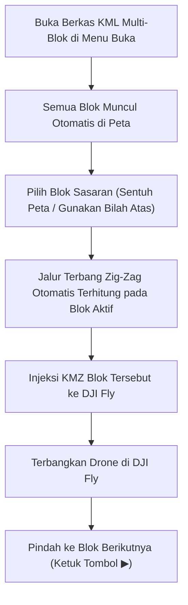

import { Tabs, TabItem } from '@astrojs/starlight/components';

Dalam operasi pemetaan perkebunan kelapa sawit, konsesi hutan tanaman industri (HTI), maupun wilayah pertambangan skala besar, batas wilayah kerja umumnya dibagikan oleh tim GIS kantor dalam satu berkas KML terpadu yang berisi **puluhan blok poligon terpisah** (contohnya berkas perkebunan `MUBA.kml` dengan 33 blok divisi seluas total 4.769 Hektar).

Mulai versi **v1.8.0**, **TW-Mapper Mobile** menghadirkan fitur **Multi-Area KML Workspace Engine**. Anda tidak perlu lagi memotong-motong file KML satu per satu di laptop sebelum berangkat ke kebun. Seluruh blok langsung terbaca sekaligus di layar remote controller Anda!

---

## 📋 Alur Kerja Multi-Area di Lapangan



---

## 🕹️ Mengenal Bilah Samping Khusus Blok Area & Indikator Minimalis

Untuk menjaga area kanvas peta satelit tetap luas, bersih, dan **100% bebas dari tumpang tindih (*zero overlap*)**, TW-Mapper menggunakan arsitektur antarmuka dua pilar:

### 1. Bilah Samping Khusus Blok Area (`[ 📑 BLOK > ]`)
Di sisi kiri tepi layar, kini terdapat tab pendamping yang sejajar dengan tab parameter:
- **`[ PARAMETER > ]`**: Membuka pengaturan ketinggian, kecepatan, overlap, dan kamera.
- **`[ 📑 BLOK (N) > ]`**: Membuka **Bilah Samping Khusus Blok Area (Multi-Area Panel)**.

```
┌────────────────────────────────┐
│  ▶ PARAMETER                   │
├────────────────────────────────┤
│  ▶ 📑 BLOK (1/33)              │
└────────────────────────────────┘
```

Menyentuh tab ini akan membuka panel bilah samping ultra-minimalis yang rapi, berdensitas tinggi, dan sangat hemat memori:
- **Header Tunggal Ramping**: Memuat jumlah blok dan total luas hektar dalam satu baris yang rapi.
- **Status & Nama Blok**: Melihat seluruh daftar blok kebun, afdeling, dan luas hektarnya ($Ha$) secara ringkas dengan kartu blok ramah sentuh jari di layar DJI RC 2 (area sentuh minimal 36dp).
- **Tombol Aksi Aman Sentuh**: Tombol ubah nama dan hapus blok memiliki jarak aman dan ukuran tombol nyaman agar pilot tidak salah pencet saat bekerja di lapangan.
- **Draf Multi-Blok Otomatis Terjaga**: Ketika aplikasi berpindah ke DJI Fly di DJI RC 2, seluruh daftar blok Multi-Area dan posisi blok aktif tetap tersimpan utuh di *Auto-Draft* sehingga tidak hilang saat pilot kembali ke TW-Mapper.
- **Navigasi Cepat (◀ dan ▶)**: Berpindah blok sasaran hanya dengan satu sentuhan tanpa repot.
- **Titik Takeoff (`H`) Mandiri Per Area**: Setiap blok di misi Multi-Area kini memiliki titik **Takeoff (`H`) dan elevasi acuan masing-masing**. Status ketersediaan takeoff ditampilkan langsung pada daftar blok (`H ✓` jika sudah diatur, `H -` jika belum), dan marker `H` setiap blok terlihat jelas di peta, laporan PDF, maupun arsip KML/KMZ/JSON proyek.
- **Pencarian Cepat (*Search*)**: Menemukan nama blok secara instan dari puluhan hingga ratusan partisi kebun. *(Untuk menambah blok baru, gunakan tombol **Tambah Blok Misi** langsung di dalam **Mode Edit** peta).*

### 2. Tampilan Peta Bersih: Tombol Blok Aktif Tersembunyi Otomatis
Untuk memastikan kenyamanan pilot saat mengedit sudut poligon atau memeriksa jalur terbang:
- **Pada Blok Aktif**: Tombol label di tengah poligon **disembunyikan sepenuhnya** sehingga kanvas bersih dan tidak ada tombol besar yang menghalangi sentuhan jari pilot.
- **Pada Blok Tidak Aktif**: Ditampilkan dalam bentuk pil minimalis ramping berukuran kecil (`Blok 2 • 142.5Ha`) dengan indikator titik kuning, sehingga peta tetap rapi dan tidak penuh.

### 3. Indikator Parameter Utama Minimalis (Dipepetkan ke Bar Atas)
Bilah indikator parameter terbang (*Luas, Jarak, Waktu, Foto, Baterai, WP, GSD*) kini **dipepetkan langsung pada bar atas layar (`top: 0`)** dengan desain minimalis ultra-ramping (tinggi 24dp):
- Bagian atas rata menempel langsung pada bilah judul (*CustomTitleBar*), dan bagian bawah melengkung halus (*docked ribbon shape*).
- Menghilangkan celah kosong (*gap*) mengambang di langit peta sehingga tidak menutupi orientasi terbang maupun poligon kerja pilot.

---

## 💾 Logika & Metode Penyimpanan Multi-Area

Memahami format penyimpanan sangat penting agar data proyek perkebunan Anda tersimpan aman dan teratur:

| Format Berkas | Peruntukan Utama | Kapabilitas Multi-Blok | Keterangan & Kompatibilitas |
| :--- | :--- | :---: | :--- |
| **Master KML (`.kml`)** | **Penyimpanan Master Proyek Kebun** | **Ya (Seluruh Blok)** | Format standar OGC KML 2.2. Menyimpan seluruh batas poligon blok lengkap dengan styling warna, koordinat **Takeoff (`H`) masing-masing blok**, serta parameter terbang (*altitude, speed, overlap, sidelap, drone, aktif blok*) di dalam `<ExtendedData>`. Dapat dibuka langsung di Google Earth (3D) dan TW-Mapper tanpa perlu mengatur ulang parameter. |
| **Master Proyek JSON (`.json`)** | **Cadangan Lengkap Proyek TW-Mapper** | **Ya (Seluruh Blok)** | Menyimpan seluruh geometri, waypoint, partisi blok, koordinat takeoff per blok, dan parameter secara detail untuk restorasi internal. |
| **DJI KMZ (`.kmz`)** | **Eksekusi Terbang di DJI Fly** | **Blok Aktif Saja** | Karena arsitektur DJI Fly hanya menjalankan 1 misi jalur terbang dalam satu waktu, ekspor KMZ otomatis menamai dan mengemas rute dari **blok yang sedang aktif** (misal: `Kebun Sawit MUBA (Blok 1) (Mavic 3E).kmz`). |

### Pratinjau Bersih & Terpadu di Menu Buka Misi
Saat Anda memilih berkas KML multi-blok (seperti `MUBA.kml`) di menu **Buka Misi**:
- Mini-map pratinjau secara otomatis mencakup **seluruh cakupan area kebun** dari ujung ke ujung menggunakan pembingkaian cerdas (*auto-fit bounds*).
- **Warna Cerah & Kontras Unik Per Blok**: Setiap blok digambar dengan warna berbeda (Cyan, Amber, Hot Pink, Neon Green, Orange, Purple, Lime, dsb.) yang sangat kontras di atas citra satelit, sehingga tidak ada dua blok yang berwarna sama.
- Menampilkan cakupan visual poligon batas area yang bersih di atas citra satelit tanpa indikator penerbangan yang tidak relevan (tanpa rute A/B, garis terbang, atau perkiraan foto).
- Di bilah atas pratinjau, disajikan ringkasan instan: `[N] BLOK • [Total Luas] Ha`, sehingga pilot langsung mengetahui isi berkas sebelum memuatnya ke kanvas.

---

## 🚀 Panduan Operasional Langkah Demi Langkah

### Langkah 1: Membuka Berkas KML Multi-Area
1. Ketuk ikon folder **Buka** di bilah judul atas.
2. Pilih opsi **KML / KMZ**.
3. Cari berkas KML Anda (misal: `MUBA.kml` dari flashdisk USB atau kartu microSD).
4. Aplikasi akan langsung mendeteksi seluruh poligon yang ada di dalam berkas tersebut dan menyusunnya menjadi daftar blok siap pakai dengan warna-warni kontras tinggi yang unik.

> [!NOTE]
> *TW-Mapper membaca nama setiap blok dari tag `<name>` di dalam KML asli. Jika tag nama kosong, aplikasi secara otomatis menamai blok sebagai `Blok 1`, `Blok 2`, dst.*

> [!TIP]
> **Default Pintar Multi-Boundaries (Ketinggian 200m, Interval Waktu & Jalur Efektif Sisi 1)**:
> Setiap kali membuka berkas KML maupun KMZ dengan banyak batas area (*multi-boundaries* seperti SK RDAS, konsesi kebun sawit, atau partisi blok tambang), TW-Mapper secara cerdas langsung menerapkan nilai default awal paling efisien sebelum pengguna mengubah dan menyimpannya sendiri:
> 1. **Pemicu Kamera Interval Waktu (*TimeShoot*)**: Otomatis mengaktifkan pemotretan berbasis interval waktu (*auto-shutter*), memangkas jumlah waypoint hingga di bawah 10% dan memastikan misi bebas dari kendala batas waypoint DJI (maksimal 65.535 WP).
> 2. **Ketinggian Otomatis 200 Meter**: Ketinggian terbang langsung diatur ke 200 meter untuk survei area luas agar cakupan tapak foto per lajur maksimal, jarak tempuh hemat, dan konsumsi baterai optimal.
> 3. **Jalur Efektif Sisi 1 (Sejajar Sisi Terpanjang)**: Jalur terbang otomatis mengunci orientasi terpanjang poligon (Sisi 1) guna meminimalkan manuver belokan dan putaran drone.
> 
> **Penyimpanan Parameter Kustom Pilot**:
> Nilai di atas adalah standar awal sebelum diubah. Jika Anda mengubah ketinggian (misal menjadi 150m), mengganti sisi jalur (Sisi 2/3/4), atau memilih pemicu jarak, lalu menyimpan misi tersebut ke berkas KML/KMZ proyek, TW-Mapper akan **mengingat dan memuat seutuhnya parameter tersimpan Anda** saat berkas tersebut dibuka kembali di masa depan tanpa menimpanya dengan nilai default.

---

### Langkah 2: Mengelola Blok dengan Bilah Samping Khusus & Navigasi Peta

Anda dapat mengaktifkan dan mengelola blok yang ingin dipetakan dengan berbagai metode yang sangat fleksibel:

#### Cara A: Bilah Samping Blok Minimalis (*Dedicated Sidebar*)
- Buka bilah samping blok dari menu parameter/bilah kanan.
- Desain kartu dibuat ramping satu baris per blok (*ultra-compact single-row*), sangat ringan dan hemat memori pada remote controller DJI RC 2 / RC Pro.
- Setiap baris dilengkapi indikator titik warna blok yang selaras dengan warna poligon di peta, nama blok, luas hektar, tombol ubah nama, dan tombol hapus blok.

#### Cara B: Sentuh Langsung di Peta (*Tap-to-Activate*)
- Di layar peta, blok yang sedang **aktif** memiliki garis batas tegas dengan jalur terbang lengkap. Tombol tengah pada blok aktif disembunyikan agar kanvas leluasa saat mengedit sudut poligon.
- Blok pasif lainnya ditandai dengan garis batas berwarna cerah unik dan label nama serta luas yang menempel pas (*shrink-wrap fit shape*) pada teksnya.
- Cukup **sentuh label atau poligon blok** yang ingin Anda kerjakan untuk langsung menjadikannya blok aktif!

#### Cara C: Penamaan Blok Menempel Keyboard (*Keyboard-Docked Dialog*)
- Saat Anda menambah blok baru atau mengubah nama blok, kotak dialog secara otomatis menempel persis di atas keyboard virtual (*bottom-docked with keyboard insets*).
- Kolom ketik dijamin 100% selalu tampak dan menempel langsung di atas tombol-tombol keyboard, tidak terhimpit atau terpotong di layar lanskap remote controller, dan tombol **Simpan / Mulai Gambar** berada tepat di samping kolom teks untuk kemudahan jemari pilot.

#### Cara D: Tambah Blok Misi Langsung dari Mode Edit di Peta (*In-Canvas Quick Add*)
- Saat berada dalam **Mode Edit** (menggambar poligon), di sudut kanan bawah peta tepat di atas tombol **"Tambah Titik"**, kini tersedia tombol khusus **"Tambah Blok Misi"** berwarna Cyan dengan ukuran dan profil rounded yang identik sempurna (38dp, lebar 148dp).
- Tombol **"Tambah Titik"** kini bersih tanpa simbol `+` berlebih, menyajikan antarmuka minimalis dan elegan.
- Pilot dapat mengetuk tombol **"Tambah Blok Misi"** kapan saja untuk langsung menamai dan memulai menggambar partisi blok baru di kanvas tanpa harus keluar dari mode edit atau berpindah layar.


> [!NOTE]
> *Tampilan antarmuka mode edit di sudut kanan bawah: Tombol "Tambah Blok Misi" (Cyan) bersanding simetris tepat di atas "Tambah Titik" (Hijau).*

#### Cara E: Opsi Hapus Area Pintar pada Mode Edit (*Selected vs All Areas*) & Pemulihan Undo
Saat Anda sedang berada dalam **Mode Edit** (menggambar atau mengedit sudut titik di peta) dan terdeteksi misi Multi-Boundary (lebih dari 1 blok), menekan ikon tempat sampah **"Hapus Area"** di bilah navigasi kanan atas secara otomatis menghadirkan dialog perlindungan dengan **dua pilihan tegas**:
1. **Hapus Area yang Dipilih Saja**: Hanya menghapus blok yang sedang aktif Anda buka/edit saat ini (misal: `Blok 1 • 24.5 Ha`). Seluruh blok kebun lainnya tetap aman dan utuh tersimpan di kanvas.
2. **Hapus Seluruh Area**: Menghapus seluruh blok batas misi sekaligus dan mereset kanvas jika Anda ingin membersihkan seluruh proyek kerja.

> [!TIP]
> **Dukungan Undo / Pemulihan Cerdas**: Jika Anda salah menghapus blok atau tidak sengaja membersihkan kanvas, tombol **Undo** di bilah kanan otomatis aktif, dan bar notifikasi menampilkan tombol **"Urungkan"**. Cukup sentuh **"Urungkan"** atau tombol **Undo**, maka seluruh blok area yang terhapus akan langsung dipulihkan seketika lengkap beserta koordinat dan namanya!

#### Cara F: Simpan Arsip Master KMZ Bersih (*All Blocks & Clean File Name*)
Saat Anda menekan tombol **"Simpan .KMZ"** pada misi Multi-Boundary:
1. **Nama Berkas Bersih**: Nama berkas disimpan utuh sesuai nama misi (misal: `Kebun Sawit - (Mavic 3E).kmz`) tanpa embel-embel akhiran nama blok atau part.
2. **Kemas Seluruh Blok Otomatis**: Seluruh poligon blok area, nama blok, dan palet warnanya otomatis dikemas ke dalam satu berkas KMZ (dilengkapi `doc.kml` standar GIS dan metadata proyek).
3. **Pratinjau Multi-Area Utuh**: Saat berkas KMZ tersebut dibuka kembali di menu **Buka Misi**, layar pratinjau (*preview*) secara otomatis menampilkan **seluruh blok area sekaligus** lengkap dengan label nama blok dan batas warna masing-masing.

---

### Langkah 3: Injeksi dan Eksekusi Per Blok ke DJI Fly
1. Periksa parameter ketinggian ($H$), overlap, dan model drone di panel samping.
2. Tekan tombol hijau **"Injeksi KMZ"** di kanan atas.
3. Pilih slot misi DJI Fly yang dituju, lalu tekan **"Terapkan & Timpa"**.
4. Buka aplikasi **DJI Fly** (cukup ketuk tombol navigasi bawah `FLY NAV` di layar remote).
5. Masuk ke menu Waypoint di DJI Fly dan mulai penerbangan misi blok tersebut!

---

### Langkah 4: Atur Takeoff Per Blok & Lanjutkan ke Blok Berikutnya
Karena setiap area pada misi Multi-Area kini memiliki titik **Takeoff (`H`) masing-masing**:
1. Saat Anda membuka atau menambah blok baru, tentukan titik **Takeoff (`H`)** yang paling dekat dan aman dengan lokasi blok tersebut (lewat tombol GPS atau ketuk peta). Mengubah atau menghapus `H` di satu blok **tidak memengaruhi** titik `H` di blok lain.
2. Setelah misi blok pertama selesai dan drone mendarat, kembali ke TW-Mapper melalui bilah bawah (`TOOLS`).
3. Tekan tombol **▶ (Next)** di bilah atas atau sentuh label blok di peta untuk beralih ke blok selanjutnya — titik `H`, garis transit, dan *Follow Terrain* (bila aktif) otomatis mengikuti konfigurasi blok yang baru dipilih.
4. Lakukan injeksi ke slot DJI Fly, ganti baterai bila perlu, lalu lepas landas dari titik takeoff blok tersebut.

---

## 💡 Tips Efisiensi untuk Pilot Lapangan

> [!TIP]
> **1. Rute Berurutan Menghemat Baterai**:
> Gunakan tombol panah `◀` dan `▶` untuk memetakan blok-blok yang saling bersebelahan secara berurutan. Ini meminimalkan jarak terbang transit drone (*outbound/return transit*) dari titik takeoff Anda.

> [!TIP]
> **2. Pembagian Misi Otomatis**:
> Jika salah satu blok berukuran sangat besar (misal > 200 Hektar) dan memerlukan lebih dari 1 set baterai, Anda dapat memanfaatkan fitur **Bagi Misi (Split Mission)** di panel kanan agar jalur terbagi rapi sesuai kapasitas baterai drone Anda.
