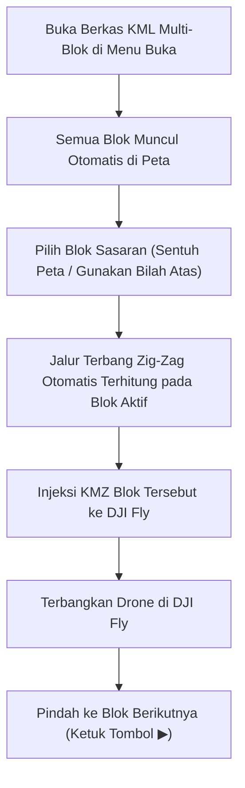

import { Tabs, TabItem } from '@astrojs/starlight/components';

Dalam operasi pemetaan perkebunan kelapa sawit, konsesi hutan tanaman industri (HTI), maupun wilayah pertambangan skala besar, batas wilayah kerja umumnya dibagikan oleh tim GIS kantor dalam satu berkas KML terpadu yang berisi **puluhan blok poligon terpisah** (contohnya berkas perkebunan `MUBA.kml` dengan 33 blok divisi seluas total 4.769 Hektar).

Mulai versi **v1.8.0**, **TW-Mapper Mobile** menghadirkan fitur **Multi-Area KML Workspace Engine**. Anda tidak perlu lagi memotong-motong file KML satu per satu di laptop sebelum berangkat ke kebun. Seluruh blok langsung terbaca sekaligus di layar remote controller Anda!

---

## 📋 Alur Kerja Multi-Area di Lapangan



---

## 🕹️ Mengenal Bilah Samping Khusus Blok Area & Indikator Minimalis

Untuk menjaga area kanvas peta satelit tetap luas, bersih, dan **100% bebas dari tumpang tindih (*zero overlap*)**, TW-Mapper menggunakan arsitektur antarmuka dua pilar:

### 1. Bilah Samping Khusus Blok Area (`[ 📑 BLOK > ]`)
Di sisi kiri tepi layar, kini terdapat tab pendamping yang sejajar dengan tab parameter:
- **`[ PARAMETER > ]`**: Membuka pengaturan ketinggian, kecepatan, overlap, dan kamera.
- **`[ 📑 BLOK (N) > ]`**: Membuka **Bilah Samping Khusus Blok Area (Multi-Area Panel)**.

```
┌────────────────────────────────┐
│  ▶ PARAMETER                   │
├────────────────────────────────┤
│  ▶ 📑 BLOK (1/33)              │
└────────────────────────────────┘
```

Menyentuh tab ini akan membuka panel bilah samping ultra-minimalis yang rapi, berdensitas tinggi, dan sangat hemat memori:
- **Header Tunggal Ramping (26dp)**: Memuat judul bilah, jumlah blok, dan total luas hektar dalam satu baris tanpa ruang kosong yang membuang ruang layar.
- **Status & Nama Blok**: Melihat seluruh daftar blok kebun, afdeling, dan luas hektarnya ($Ha$) secara ringkas dengan kartu blok berukuran mikro.
- **Tombol Aksi Terkluster Rapat**: Tombol ubah nama dan hapus blok didesain rapat berdampingan (*micro-action cluster*), menghemat ruang horizontal sehingga nama blok terbaca penuh tanpa terpotong.
- **Navigasi Cepat (◀ dan ▶)**: Berpindah blok sasaran hanya dengan satu sentuhan tanpa repot.
- **Pencarian Cepat (*Search*)**: Menemukan nama blok secara instan dari puluhan hingga ratusan partisi kebun.
- **Tombol Hijau "+ Tambah Blok Baru"**: Menambahkan poligon blok baru langsung dari bilah samping tanpa memadati kanvas peta.

### 2. Tampilan Peta Bersih: Tombol Blok Aktif Tersembunyi Otomatis
Untuk memastikan kenyamanan pilot saat mengedit sudut poligon atau memeriksa jalur terbang:
- **Pada Blok Aktif**: Tombol label di tengah poligon **disembunyikan sepenuhnya** sehingga kanvas bersih dan tidak ada tombol besar yang menghalangi sentuhan jari pilot.
- **Pada Blok Tidak Aktif**: Ditampilkan dalam bentuk pil minimalis ramping berukuran kecil (`Blok 2 • 142.5Ha`) dengan indikator titik kuning, sehingga peta tetap rapi dan tidak penuh.

### 3. Indikator Parameter Utama Minimalis (Dipepetkan ke Bar Atas)
Bilah indikator parameter terbang (*Luas, Jarak, Waktu, Foto, Baterai, WP, GSD*) kini **dipepetkan langsung pada bar atas layar (`top: 0`)** dengan desain minimalis ultra-ramping (tinggi 24dp):
- Bagian atas rata menempel langsung pada bilah judul (*CustomTitleBar*), dan bagian bawah melengkung halus (*docked ribbon shape*).
- Menghilangkan celah kosong (*gap*) mengambang di langit peta sehingga tidak menutupi orientasi terbang maupun poligon kerja pilot.

---

## 💾 Logika & Metode Penyimpanan Multi-Area

Memahami format penyimpanan sangat penting agar data proyek perkebunan Anda tersimpan aman dan teratur:

| Format Berkas | Peruntukan Utama | Kapabilitas Multi-Blok | Keterangan & Kompatibilitas |
| :--- | :--- | :---: | :--- |
| **Master KML (`.kml`)** | **Penyimpanan Master Proyek Kebun** | **Ya (Seluruh Blok)** | Format standar OGC KML 2.2. Menyimpan seluruh batas poligon blok lengkap dengan styling warna, serta menyimpan parameter terbang (*altitude, speed, overlap, sidelap, drone, aktif blok*) di dalam `<ExtendedData>`. Dapat dibuka langsung di Google Earth (3D) dan TW-Mapper tanpa perlu mengatur ulang parameter. |
| **Master Proyek JSON (`.json`)** | **Cadangan Lengkap Proyek TW-Mapper** | **Ya (Seluruh Blok)** | Menyimpan seluruh geometri, waypoint, partisi blok, dan parameter secara detail untuk restorasi internal. |
| **DJI KMZ (`.kmz`)** | **Eksekusi Terbang di DJI Fly** | **Blok Aktif Saja** | Karena arsitektur DJI Fly hanya menjalankan 1 misi jalur terbang dalam satu waktu, ekspor KMZ otomatis menamai dan mengemas rute dari **blok yang sedang aktif** (misal: `Kebun Sawit MUBA (Blok 1) (Mavic 3E).kmz`). |

### Pratinjau Bersih & Terpadu di Menu Buka Misi
Saat Anda memilih berkas KML multi-blok (seperti `MUBA.kml`) di menu **Buka Misi**:
- Mini-map pratinjau secara otomatis mencakup **seluruh cakupan area kebun** dari ujung ke ujung menggunakan pembingkaian cerdas (*auto-fit bounds*).
- **Warna Cerah & Kontras Unik Per Blok**: Setiap blok digambar dengan warna berbeda (Cyan, Amber, Hot Pink, Neon Green, Orange, Purple, Lime, dsb.) yang sangat kontras di atas citra satelit, sehingga tidak ada dua blok yang berwarna sama.
- Menampilkan cakupan visual poligon batas area yang bersih di atas citra satelit tanpa indikator penerbangan yang tidak relevan (tanpa rute A/B, garis terbang, atau perkiraan foto).
- Di bilah atas pratinjau, disajikan ringkasan instan: `[N] BLOK • [Total Luas] Ha`, sehingga pilot langsung mengetahui isi berkas sebelum memuatnya ke kanvas.

---

## 🚀 Panduan Operasional Langkah Demi Langkah

### Langkah 1: Membuka Berkas KML Multi-Area
1. Ketuk ikon folder **Buka** di bilah judul atas.
2. Pilih opsi **KML / KMZ**.
3. Cari berkas KML Anda (misal: `MUBA.kml` dari flashdisk USB atau kartu microSD).
4. Aplikasi akan langsung mendeteksi seluruh poligon yang ada di dalam berkas tersebut dan menyusunnya menjadi daftar blok siap pakai dengan warna-warni kontras tinggi yang unik.

> [!NOTE]
> *TW-Mapper membaca nama setiap blok dari tag `<name>` di dalam KML asli. Jika tag nama kosong, aplikasi secara otomatis menamai blok sebagai `Blok 1`, `Blok 2`, dst.*

> [!TIP]
> **Otomatis Dialihkan ke Interval Waktu (*TimeShoot*)**:
> Saat berkas KML multi-area dimuat, TW-Mapper secara cerdas otomatis mengalihkan parameter pemicu foto ke **Interval Waktu (*TimeShoot*)**. Ini memangkas jumlah waypoint secara drastis (hanya menaruh waypoint di ujung dan belokan lajur) sehingga penerbangan sangat mulus dan bebas dari batas waypoint DJI. Kendati demikian, pilot tetap leluasa mengubahnya kembali ke mode jarak/waypoint kapan pun melalui panel parameter samping.

---

### Langkah 2: Mengelola Blok dengan Bilah Samping Khusus & Navigasi Peta

Anda dapat mengaktifkan dan mengelola blok yang ingin dipetakan dengan berbagai metode yang sangat fleksibel:

#### Cara A: Bilah Samping Blok Minimalis (*Dedicated Sidebar*)
- Buka bilah samping blok dari menu parameter/bilah kanan.
- Desain kartu dibuat ramping satu baris per blok (*ultra-compact single-row*), sangat ringan dan hemat memori pada remote controller DJI RC 2 / RC Pro.
- Setiap baris dilengkapi indikator titik warna blok yang selaras dengan warna poligon di peta, nama blok, luas hektar, tombol ubah nama, dan tombol hapus blok.

#### Cara B: Sentuh Langsung di Peta (*Tap-to-Activate*)
- Di layar peta, blok yang sedang **aktif** memiliki garis batas tegas dengan jalur terbang lengkap. Tombol tengah pada blok aktif disembunyikan agar kanvas leluasa saat mengedit sudut poligon.
- Blok pasif lainnya ditandai dengan garis batas berwarna cerah unik dan label nama serta luas yang menempel pas (*shrink-wrap fit shape*) pada teksnya.
- Cukup **sentuh label atau poligon blok** yang ingin Anda kerjakan untuk langsung menjadikannya blok aktif!

#### Cara C: Penamaan Blok Menempel Keyboard (*Keyboard-Docked Dialog*)
- Saat Anda menambah blok baru atau mengubah nama blok, kotak dialog secara otomatis menempel persis di atas keyboard virtual (*bottom-docked with keyboard insets*).
- Kolom ketik dijamin 100% selalu tampak dan menempel langsung di atas tombol-tombol keyboard, tidak terhimpit atau terpotong di layar lanskap remote controller, dan tombol **Simpan / Mulai Gambar** berada tepat di samping kolom teks untuk kemudahan jemari pilot.

#### Cara D: Tambah Blok Misi Langsung dari Mode Edit di Peta (*In-Canvas Quick Add*)
- Saat berada dalam **Mode Edit** (menggambar poligon), di sudut kanan bawah peta tepat di atas tombol **"Tambah Titik"**, kini tersedia tombol khusus **"Tambah Blok Misi"** berwarna Cyan dengan ukuran dan profil rounded yang identik sempurna (38dp, lebar 148dp).
- Tombol **"Tambah Titik"** kini bersih tanpa simbol `+` berlebih, menyajikan antarmuka minimalis dan elegan.
- Pilot dapat mengetuk tombol **"Tambah Blok Misi"** kapan saja untuk langsung menamai dan memulai menggambar partisi blok baru di kanvas tanpa harus keluar dari mode edit atau berpindah layar.

---

### Langkah 3: Injeksi dan Eksekusi Per Blok ke DJI Fly
1. Periksa parameter ketinggian ($H$), overlap, dan model drone di panel samping.
2. Tekan tombol hijau **"Injeksi KMZ"** di kanan atas.
3. Pilih slot misi DJI Fly yang dituju, lalu tekan **"Terapkan & Timpa"**.
4. Buka aplikasi **DJI Fly** (cukup ketuk tombol navigasi bawah `FLY NAV` di layar remote).
5. Masuk ke menu Waypoint di DJI Fly dan mulai penerbangan misi blok tersebut!

---

### Langkah 4: Melanjutkan ke Blok Berikutnya
Setelah misi blok pertama selesai dan drone mendarat:
1. Kembali ke TW-Mapper melalui bilah bawah (`TOOLS`).
2. Tekan tombol **▶ (Next)** di bilah atas untuk beralih ke blok selanjutnya.
3. Lakukan injeksi kembali ke slot DJI Fly.
4. Ganti baterai drone jika diperlukan, lalu lepas landas untuk memetakan blok baru.

---

## 💡 Tips Efisiensi untuk Pilot Lapangan

> [!TIP]
> **1. Rute Berurutan Menghemat Baterai**:
> Gunakan tombol panah `◀` dan `▶` untuk memetakan blok-blok yang saling bersebelahan secara berurutan. Ini meminimalkan jarak terbang transit drone (*outbound/return transit*) dari titik takeoff Anda.

> [!TIP]
> **2. Pembagian Misi Otomatis**:
> Jika salah satu blok berukuran sangat besar (misal > 200 Hektar) dan memerlukan lebih dari 1 set baterai, Anda dapat memanfaatkan fitur **Bagi Misi (Split Mission)** di panel kanan agar jalur terbagi rapi sesuai kapasitas baterai drone Anda.
