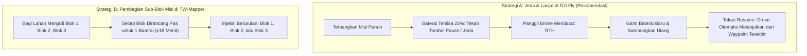

Jika Anda mendapat tugas memetakan area perkebunan kelapa sawit, konsesi tambang, atau kawasan industri seluas puluhan hingga ratusan hektar, durasi terbang satu baterai drone (rata-rata 20–25 menit waktu kerja efektif) tentu tidak akan cukup menyelesaikan seluruh area sekaligus.

TW-Mapper Mobile dan DJI Fly memiliki fitur pembagian rute dan penyambungan otomatis yang membuat pekerjaan lahan luas menjadi sangat mudah dan terkendali.

---

## 🔋 2 Strategi Pembagian Misi Lapangan

---

## 🎯 Strategi A: Jeda & Lanjut di DJI Fly (Paling Praktis)

File format WPML KMZ yang dihasilkan oleh TW-Mapper Mobile mendukung fitur *Breakpoint Resume* resmi DJI Fly:

> [!NOTE]
> *Gambar 2.5: Dialog Laporan Misi (Flight Manifest). Anda dapat memeriksa estimasi durasi total, jumlah foto, serta perhitungan kebutuhan jumlah baterai sebelum lepas landas.*

1. **Rancang Seluruh Area Lahan di TW-Mapper**:
   Gambar batas poligon kebun penuh (misal: 80 hektar, estimasi waktu terbang 55 menit).
2. **Injeksi ke DJI Fly**:
   Kirimkan rute ke DJI Fly, lalu tekan tombol mulai terbang.
3. **Saat Baterai Mendekati 25%**:
   - Tekan tombol **Jeda (Pause)** pada layar remote atau tombol darurat di remote fisik. Drone akan berhenti melayang (*hovering*).
   - Tekan tombol **Kembali ke Rumah (RTH)** untuk mendaratkan drone di dekat Anda.
4. **Ganti Baterai Baru**:
   Matikan drone, pasang baterai baru yang penuh, lalu nyalakan kembali.
5. **Lanjutkan Misi**:
   Buka kembali misi Waypoint di DJI Fly. Aplikasi akan mendeteksi titik jeda sebelumnya dan menanyakan: *"Lanjutkan misi dari Waypoint terakhir?"*. Pilih **Lanjutkan**, dan drone akan otomatis terbang lurus kembali ke titik terakhir ia berhenti!

---

## 📦 Strategi B: Pembagian Sub-Blok Lahan di TW-Mapper

Jika Anda lebih menyukai manajemen file per kelompok blok tanah (misal: *Blok Barat*, *Blok Tengah*, *Blok Timur*):

> [!NOTE]
> *Gambar 2.6: Dialog Waypoint Fallback. Jika jumlah waypoint melebihi batas remote, sistem secara cerdas menawarkan opsi beralih ke Mode Timeshoot atau membagi misi menjadi sub-blok.*

- Buat poligon untuk masing-masing blok secara terpisah.
- Amati indikator **Estimasi Waktu Terbang** di panel kanan: pastikan durasi berkisar antara **16 – 20 menit** per blok agar pas dengan kapasitas 1 baterai dengan cadangan keselamatan 25%.
- Injeksi masing-masing blok ke slot misi yang berbeda di remote kontrol.
