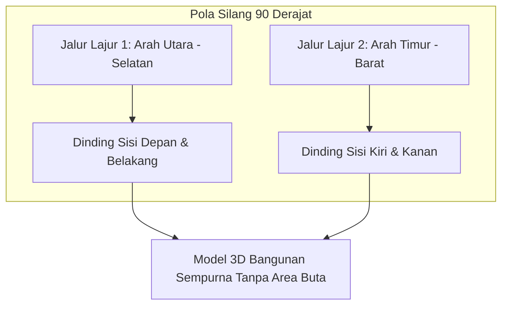

Jika ortofoto 2D biasa hanya memotret tegak lurus ke bawah (*nadir* 90°), pemodelan 3D bangunan arsitektur, monumen, tebing curam, atau jembatan membutuhkan foto dari berbagai sudut agar dinding vertikal tidak tampak gepeng atau blur.

Mode **Double Grid** di TW-Mapper menghasilkan dua set jalur terbang yang saling bersilangan 90° dalam satu rencana misi terpadu.

---

## 🏢 Langkah Perancangan Misi Double Grid

> [!NOTE]
> *Gambar 2.3: Perancangan misi 3D Double Grid. (1) Jalur grid arah pertama 0°, (2) Jalur grid arah kedua bersilangan 90°, dan (3) Sudut kemiringan gimbal oblique -60° untuk merekam tekstur fasad dinding gedung.*

### 1. Buat Batas Area Gedung
Tandai batas poligon mengelilingi bangunan atau tebing yang ingin Anda buat model 3D-nya. Berikan jarak ekstra (margin aman sekitar 20–30 meter) di sekeliling gedung agar jalur terbang drone tidak terlalu mepet dengan atap bangunan.

### 2. Atur Sudut Kemiringan Kamera (Gimbal Pitch)
Di panel pengaturan kamera, pilih sudut kemiringan gimbal:
- **-90° (Nadir)**: Kamera menghadap lurus ke bawah (untuk topografi berkontur ekstrem).
- **-60° s/d -70° (Oblique - Rekomendasi 3D)**: Kamera dimiringkan sedikit ke depan. Dengan sudut ini, kamera menangkap atap gedung sekaligus permukaan dinding jendela dan pintu secara proporsional.

### 3. Ketinggian Aman di Atas Bangunan
Pastikan ketinggian terbang drone diatur minimal **20–30 meter lebih tinggi daripada titik tertinggi bangunan atau penangkal petir terdekat** untuk menghindari risiko tabrakan fisik.

### 4. Injeksi & Eksekusi
Tekan tombol **Injeksi Misi KMZ**. Drone akan menerbangkan rute lajur pertama dari arah utara-selatan, kemudian langsung menyambung rute kedua dari arah barat-timur secara berurutan. Hasil kumpulan fotonya akan menghasilkan kerapatan *point cloud* 3D yang sangat padat saat diproses di Agisoft Metashape, Pix4D, atau DJI Terra.
