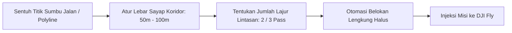

Memetakan objek yang memanjang—seperti jalan tol, rel kereta, jalur pipa minyak/gas, aliran sungai, atau kabel listrik tegangan tinggi (SUTET)—akan sangat boros baterai jika menggunakan grid kotak biasa karena drone akan banyak menerbangi lahan kosong di luar jalur.

TW-Mapper menyediakan mode khusus bernama **Misi Koridor (Corridor Mode)** yang memusatkan jalur terbang tepat mengikuti poros objek memanjang tersebut.

---

## 🛣️ Langkah Membuat Misi Koridor

> [!NOTE]
> *Gambar 2.2: Tampilan perencanaan misi koridor. (1) Sumbu tengah jalan (centerline), (2) Garis penyangga batas sayap koridor (buffer 60m), (3) 3 lajur lintasan bolak-balik dengan belokan lengkung halus, dan (4) Panel pengaturan parameter koridor.*

### Langkah 1: Aktifkan Mode Koridor
1. Pada menu utama, pilih tab mode **Koridor (Corridor)**.
2. Ketuk tombol tambah titik di sisi kiri layar.

### Langkah 2: Gambar Garis Poros (Centerline)
- Sentuh layar mengikuti poros tengah jalan atau aliran sungai dari titik awal hingga titik akhir.
- Jika jalan berbelok, cukup tambahkan titik di setiap tikungan. Garis poros jalan akan terbentuk mengikuti kontur aspal.

### Langkah 3: Tentukan Lebar Koridor Target
- Di panel pengaturan kanan, tentukan **Lebar Koridor (Corridor Width)**, misalnya **60 meter** (30 meter ke kiri dan 30 meter ke kanan poros jalan).
- Garis batas penyangga (*buffer area*) otomatis mengembang di sekeliling jalan.

### Langkah 4: Tentukan Jumlah Lajur (Pass Lines)
- **1 Jalur (Single Pass)**: Drone terbang satu arah lurus tepat di atas poros jalan. Sangat cepat, cocok untuk inspeksi visual kondisi aspal atau pipa sempit.
- **2 Jalur (Double Pass)**: Drone terbang bolak-balik menyusuri sisi kiri dan kanan jalan. Memberikan sudut pandang ganda untuk melihat dinding pembatas, tiang penerangan, atau kabel listrik.
- **3 Jalur (Triple Pass)**: Menghasilkan overlap samping (*sidelap*) 65%+ yang memadai untuk membuat peta ortofoto lengkap dan model 3D topografi badan jalan.

### Langkah 5: Injeksi & Terbang
Tekan tombol **Injeksi Misi KMZ**. Drone akan terbang mengikuti tikungan jalan dengan manuver belokan lengkung halus (*smooth curved turning*) sehingga tidak berhenti mendadak di setiap belokan, menghemat daya baterai hingga 20%.
