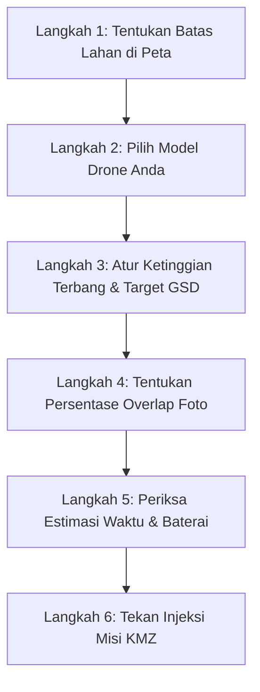

Pemetaan area lahan perkebunan, perumahan, tambang, atau kawasan persawahan adalah pekerjaan paling umum bagi pilot drone pemetaan. TW-Mapper Mobile menggunakan pola jalur zig-zag cerdas (*Boustrophedon Grid*) yang menyelaraskan rute terbang dengan sisi terpanjang lahan untuk menghemat baterai.

---

## 📋 Langkah-langkah Praktis di Layar

> [!NOTE]
> *Gambar 2.1: Tampilan perencanaan misi lahan. (1) Sentuh patok sudut kebun, (2) Batas poligon cyan dan jalur zig-zag otomatis membentang sejajar sisi terpanjang lahan, (3) Panel parameter ketinggian dan overlap, dan (4) Tombol injeksi langsung ke DJI Fly.*

### Langkah 1: Tandai Batas Lahan pada Peta
1. Buka aplikasi **TW-Mapper Mobile**.
2. Geser peta ke lokasi lahan yang ingin Anda petakan.
3. Ketuk ikon **Pensil/Titik (📍)** pada bilah alat kiri.
4. Sentuh layar di setiap sudut patok batas tanah Anda (minimal 3 titik). Garis batas poligon berwarna cyan akan otomatis menghubungkan setiap titik.
5. Secara otomatis, jalur garis terbang bergaris zig-zag akan terbentang rapi di dalam lahan Anda.

### Langkah 2: Pilih Model Drone Anda
Di panel sebelah kanan, pilih tipe drone yang Anda gunakan hari ini (misal: **DJI Air 3** atau **Mini 4 Pro**). Aplikasi akan langsung mengambil data ukuran sensor dan lensa kamera drone tersebut secara presisi.

### Langkah 3: Atur Ketinggian Terbang ($H$)
- Geser slider ketinggian, misalnya ke angka **80 meter**.
- Perhatikan label **GSD**: Di ketinggian 80m pada DJI Air 3, resolusi tanah adalah sekitar **2.1 cm/pixel**.
- *Aturan umum*: Makin tinggi terbang, cakupan area makin luas dan cepat selesai, namun detail pixel tanah makin besar.

### Langkah 4: Atur Overlap Foto (Frontlap & Sidelap)
- **Frontlap (Overlap Depan)**: Atur di rentang **75% – 80%**. Ini adalah persentase tumpang-tindih foto searah laju terbang drone.
- **Sidelap (Overlap Samping)**: Atur di rentang **65% – 70%**. Ini adalah jarak tumpang-tindih antar baris lajur terbang yang bersebelahan.

### Langkah 5: Amati Kecepatan Aman
Perhatikan slider kecepatan. Jika Anda memilih overlap rapat di ketinggian rendah, sistem secara otomatis membatasi kecepatan maksimum (misal: 6.0 m/s) agar kamera tidak kepayahan menyimpan foto ke kartu memori.

### Langkah 6: Tekan Tombol "Injeksi Misi KMZ"
1. Tekan tombol biru besar **"Injeksi Misi KMZ"**.
2. Pilih slot misi di DJI Fly yang ingin Anda gunakan.
3. Tekan **"Terapkan & Timpa"**.
4. Misi Anda kini sudah tersimpan rapi di dalam DJI Fly dan siap diterbangkan!
